# Endpoints

Every route this build serves, in the order a client needs them: what it is for, who
calls it, what it calls, the exact wire shape, and what it deliberately does not do.

Canonical schema and the full future surface: [`v2-api.md`](./v2-api.md). This file is
the **implemented** contract; when the two disagree, this file describes the binary
and `v2-api.md` describes the target.

- Base URL: `http://localhost:8080`, no version prefix.
- Dates `YYYY-MM-DD`, timestamps RFC 3339 UTC, money **integer minor-unit strings**
  (`"-25000"`), never floats.
- Errors are one envelope: `{"error":{"code":"…","message":"…"}}`.
- Pagination: `?cursor=&limit=`, default 50, max 200.

## Routes at a glance

| # | method | path | auth | purpose |
| --- | --- | --- | --- | --- |
| 1 | `GET` | `/healthz` | none | liveness, build identity, schema version |
| 2 | `POST` | `/api/session` | none | exchange the password for a cookie |
| 3 | `POST` | `/api/password` | session | replace the generated password |
| 4 | `GET` | `/api/settings` | session | read the in-app settings |
| 5 | `PATCH` | `/api/settings` | session | change the base currency while the ledger is empty |
| 6 | `GET` | `/api/meta` | session | bootstrap payload for the shell |
| 7 | `GET` | `/api/entries` | session | list the ledger, newest first |
| 8 | `POST` | `/api/entries` | session | post a balanced entry |
| 9 | `PATCH` | `/api/entries/{id}` | session | void an entry (reversal, never delete) |
| 10 | `GET` | `/api/captures` | session | the review queue |
| 11 | `POST` | `/api/captures` | session | queue a capture (text or file) |
| 12 | `PATCH` | `/api/captures/{id}` | session | approve, reject, retry |
| — | any | anything else | — | `404 not_found` |

**Auth model.** One password, stored sealed in the `settings` row. While no password
exists the API is open (a self-hosted box on your own network). Once set, every
`/api/*` route except `POST /api/session` requires the `spenicle_session` cookie and
answers `401 unauthorized` without it. The cookie is derived from `APP_SECRET`, so
rotating the secret signs everyone out.

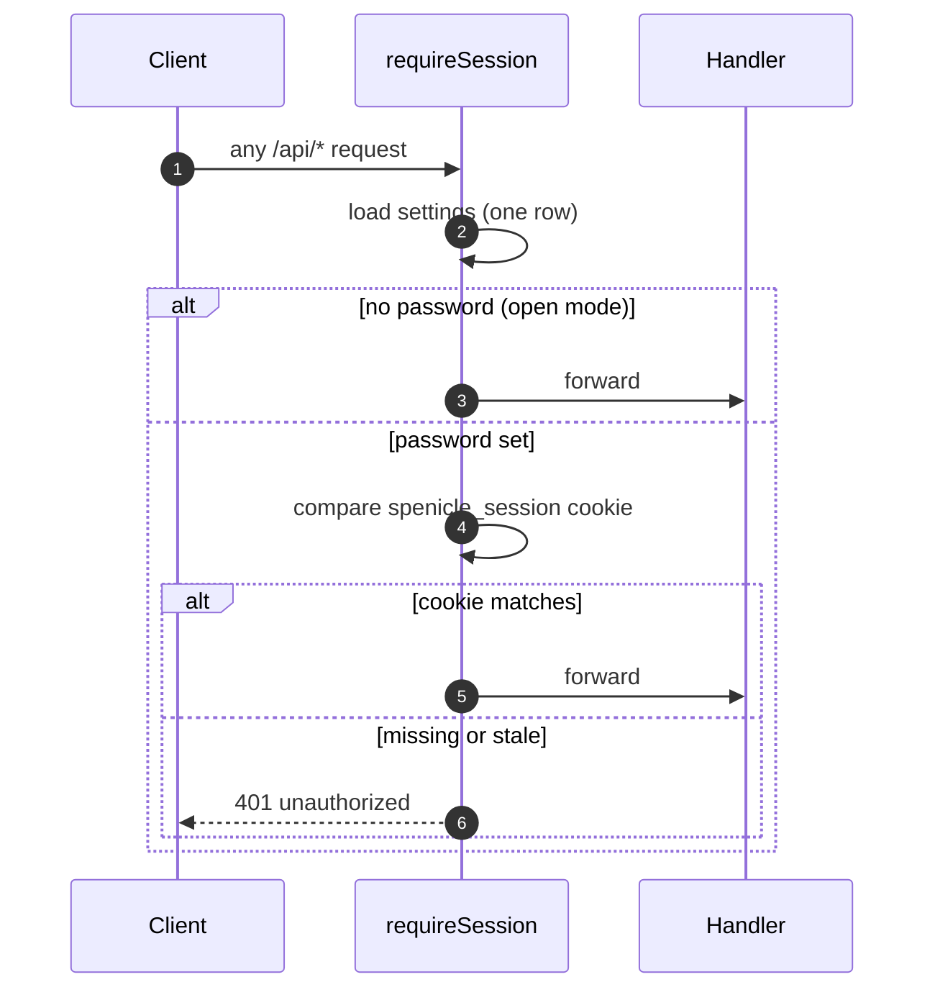

---

## 1. `GET /healthz`

**Purpose.** Prove the process is alive, which build it is, and that the database is
reachable — the first call any monitor, agent or release script makes.

**Upstream.** Container healthcheck, `skills/release`, an agent's first call.
**Downstream.** `Repository.Sqlite.SchemaVersion` (`SELECT MAX(version)`), then
`Repository.Sqlite.Ping` (`SELECT 1`). It does **not** touch the ledger.

**Params.** None. **Body.** None.

**200**

```json
{"status":"ok","version":"v0.1.1+e0d15ce","schema_version":2,"app_secret":"41539bfba9c4a1ec","base_currency":"IDR"}
```

**Errors.** `503 degraded` with the database error message when either query fails.

**Limitations.** No deep checks (no FX fetch, no vendor ping); `app_secret` is a
fingerprint, never the secret. `base_currency` is the value captured at boot.

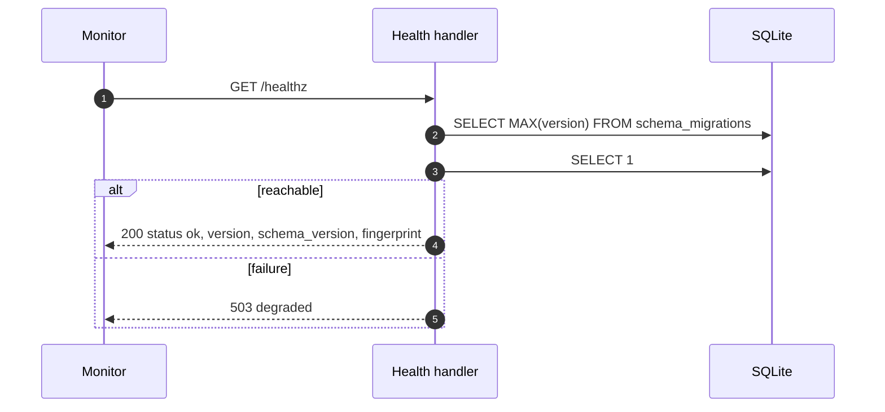

---

## 2. `POST /api/session`

**Purpose.** Exchange the password for a session cookie. The first password is
generated at boot, printed once in the log, and flagged `must_change`.

**Upstream.** Login screen, scripts that want a cookie.
**Downstream.** `Module.Settings.Authenticate` → `settings` row (sealed JSON, opened
with `APP_SECRET`), then `Module.Settings.SessionToken`.

**Path / query params.** None.

**Body**

| field | type | required | notes |
| --- | --- | --- | --- |
| `password` | string | yes | compared in constant time |

**200** `{"status":"signed_in","must_change":true}` + `Set-Cookie: spenicle_session=…`
(`HttpOnly`, `SameSite=Lax`, `Secure` when served over TLS, 30 days).

**Errors.** `401 invalid_password`; `409 no_password_set` when the instance is in open
mode; `400 invalid_json`.

**Limitations.** No rate limiting yet; no logout route (clear the cookie client-side);
one user, no usernames.

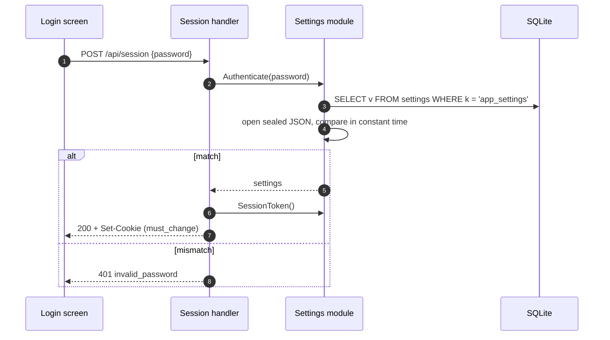

---

## 3. `POST /api/password`

**Purpose.** Replace the generated password with the user's own and clear
`password_must_change`.

**Upstream.** The forced change screen after the first sign-in.
**Downstream.** `Module.Settings.ChangePassword` → re-seal and upsert `app_settings`.

**Body**

| field | type | required | notes |
| --- | --- | --- | --- |
| `current_password` | string | yes | verified first |
| `new_password` | string | yes | ≥ 12 characters |

**200** `{"base_currency":"IDR","password_must_change":false,"extraction_enabled":false}`

**Errors.** `401 invalid_password` (wrong current, or no password set);
`422 weak_password`; `400 invalid_json`.

**Limitations.** No history, no reuse check, no "sign out other devices" — one cookie
per deployment, derived from the secret.

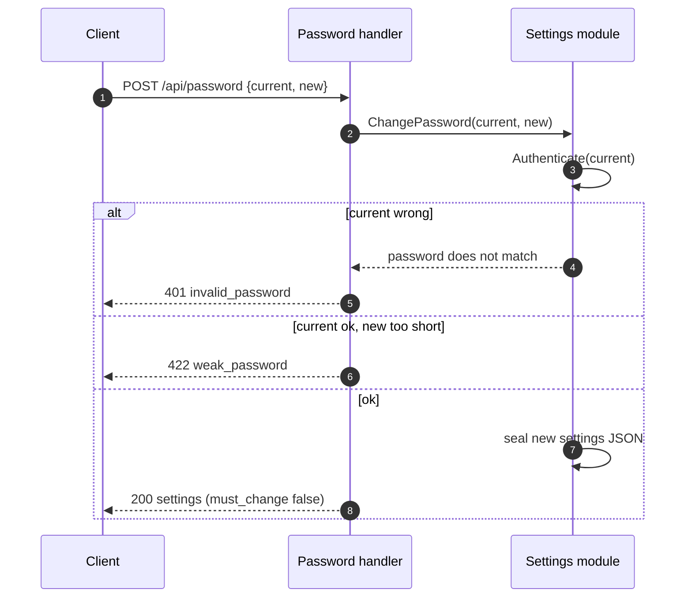

---

## 4. `GET /api/settings`

**Purpose.** What the shell reads instead of environment variables.

**Upstream.** Settings screen; anything that needs to know whether extraction is on.
**Downstream.** `Module.Settings.Load` → `settings` row.

**Params / body.** None.

**200** `{"base_currency":"IDR","password_must_change":false,"extraction_enabled":false}`

**Limitations.** `extraction_enabled` reflects whether `SNAPTOJSON_API_KEY` is set at
boot; it is not editable through the API yet.

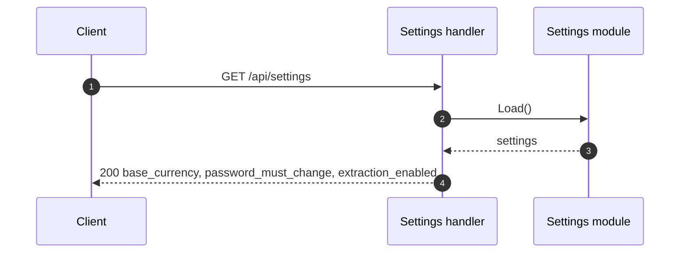

---

## 5. `PATCH /api/settings`

**Purpose.** Choose the reporting currency. Allowed only while the ledger is empty:
after the first entry the numbers would stop meaning the same thing.

**Upstream.** Setup wizard / settings screen before the first entry.
**Downstream.** `Module.Settings.SetBaseCurrency` → `Repository.Sqlite.HasEntries`
(`SELECT EXISTS(… ledger_entries)`), then re-seal the settings row.

**Body**

| field | type | required | notes |
| --- | --- | --- | --- |
| `base_currency` | string | yes (today) | ISO 4217, case-insensitive |

**200** `{"base_currency":"USD", …}`

**Errors.** `409 base_currency_locked` once any entry exists; `422 unknown_currency`;
`422 empty_patch` when the body has nothing to change; `400 invalid_json`.

**Limitations.** Only `base_currency` is patchable so far; no reset of the entry lock —
voiding entries does not unlock it, by design (the decision was made).

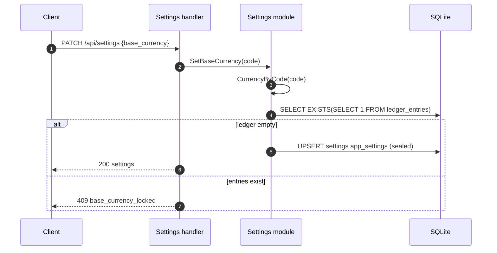

---

## 6. `GET /api/meta`

**Purpose.** One round trip fills the shell: settings, every account with a derived
balance, and the embedded currency list.

**Upstream.** PWA bootstrap, agents discovering account ids.
**Downstream.** `Module.Settings.Load`; `Repository.Sqlite.ListAccounts`;
`Repository.Sqlite.BalancesByAccount` (`SUM(base_amount_minor)` grouped by account);
`entity.Currencies()` (compiled-in list, no table).

**Params / body.** None.

**200**

```json
{"settings":{"base_currency":"IDR","extraction_enabled":false},
 "accounts":[{"id":1,"name":"Cash","kind":"asset","currency":"IDR",
              "base_amount_minor":"0","archived":false}],
 "currencies":[{"code":"AUD","minor_units":2,"symbol":"A$"}]}
```

**Limitations.** No payees or recurring rules yet (both tables exist, no endpoints);
balances are all-time, not per month.

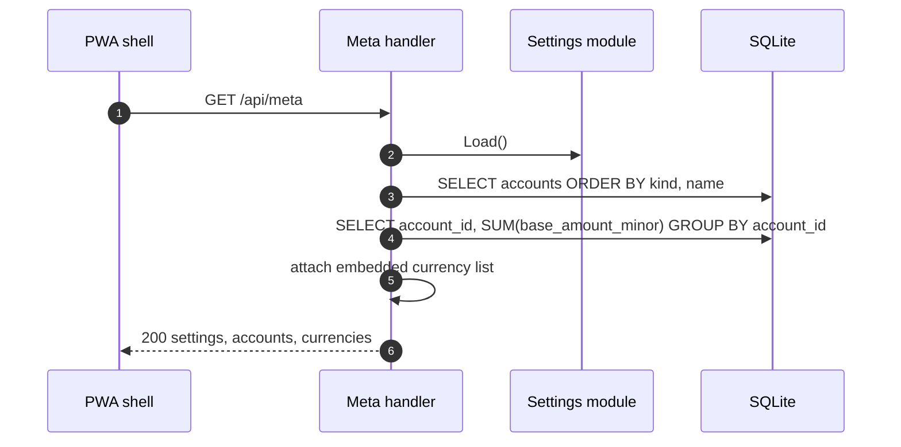

---

## 7. `GET /api/entries`

**Purpose.** Read the ledger: newest first, filtered, paged, postings included.

**Upstream.** Ledger screen, agents auditing spend, `skills/ai-integration`.
**Downstream.** `Module.Ledger.List` → `Repository.Sqlite.ListEntries` (one query for
entries, one per entry for its postings).

**Query params**

| name | type | default | notes |
| --- | --- | --- | --- |
| `from` | date | — | `occurred_on >= from` |
| `to` | date | — | `occurred_on <= to` |
| `account_id` | int | — | entries touching that account |
| `payee_id` | int | — | entries for that payee |
| `source` | string | — | `manual`, `share`, `email`, `statement`, `recurring`, `adjustment` |
| `cursor` | int | — | return entries with `id < cursor` |
| `limit` | int | 50 | clamped to 200 |

**200** `{"entries":[{"id":1,"occurred_on":"2026-02-14","currency":"IDR","source":"manual","postings":[…]}],"next_cursor":0}`

**Errors.** `400 invalid_filter` for a malformed date or cursor.

**Limitations.** Offset-free cursor paging only; no running balance (`running_balance`
from the design is not implemented); postings are loaded per entry (N+1), acceptable at
one user's volume.

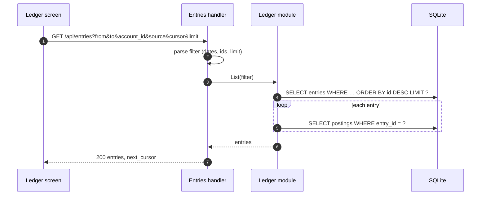

---

## 8. `POST /api/entries`

**Purpose.** Post one balanced entry. The only way money enters the ledger.

**Upstream.** Manual entry screen, agents, approvals from captures.
**Downstream.** `Module.Ledger.Post`: idempotency lookup by `client_id`, base currency
from settings, per-posting FX conversion (`big.Rat`, one rounding), `entity.NewEntry`
(`CheckZeroSum`), then one transaction in `Repository.Sqlite.InsertEntry` (entry +
postings + `audit_log`). Zero-sum is checked again inside the transaction.

**Body**

| field | type | required | notes |
| --- | --- | --- | --- |
| `client_id` | string | no | UUIDv7; a replay returns the stored entry |
| `occurred_on` | date | yes | any month, past or future |
| `payee_id` | int | no | |
| `note` | string | no | |
| `currency` | string | yes | ISO 4217 of the postings |
| `source` | string | no | defaults to `manual` |
| `postings` | array | yes | ≥ 2, sums to zero |
| `postings[].account_id` | int | yes | |
| `postings[].amount_minor` | string | yes | signed integer string |
| `postings[].fx_rate` | string | no | required when `currency` ≠ base |
| `postings[].fx_rate_date` | string | no | |

**201** created, **200** when the `client_id` was already posted (same body).

**Errors.** `422 postings_not_balanced`, `422 invalid_postings`, `422 unknown_currency`,
`422 invalid_rate`, `422 invalid_request` (bad date or amount), `400 invalid_json`.

**Limitations.** No ECB rate resolution yet: a foreign entry must send `fx_rate`.
No field edits after posting (void and re-post). No payee validation.

```mermaid
sequenceDiagram
    autonumber
    participant C as Client
    participant H as Entries handler
    participant L as Ledger module
    participant S as Settings module
    participant DB as SQLite
    C->>H: POST /api/entries {currency, postings, client_id}
    H->>H: parse amounts (minor units as strings)
    H->>L: Post(input)
    opt client_id present
        L->>DB: SELECT entry WHERE client_id = ?
        alt replay
            L-->>H: stored entry, created=false
            H-->>C: 200 existing entry
        end
    end
    L->>S: BaseCurrency()
    L->>L: convert each posting (big.Rat, one rounding)
    L->>L: CheckZeroSum(native, base)
    L->>DB: BEGIN; INSERT entry; INSERT postings; INSERT audit; COMMIT
    L-->>H: entry, created=true
    H-->>C: 201 entry
```

---

## 9. `PATCH /api/entries/{id}`

**Purpose.** Void an entry. The ledger never deletes: it writes the compensating entry
and stamps `voided_at` on the original, in one transaction.

**Upstream.** Ledger screen ("I logged this twice").
**Downstream.** `Module.Ledger.Void` → `Repository.Sqlite.VoidEntry`: read the original,
negate every posting, insert the reversal with `reverses_entry_id`, `UPDATE … voided_at
WHERE voided_at IS NULL`, insert `audit_log` action `void`.

**Path params.** `id` (int, required).

**Body**

| field | type | required | notes |
| --- | --- | --- | --- |
| `void` | bool | yes | must be `true` |
| `reason` | string | no | becomes the reversal's note |

**200** the **reversal** entry (`source":"adjustment"`, negated amounts).

**Errors.** `404 not_found`; `409 invalid_state` (already voided); `422
unsupported_patch` for any other field edit; `422 invalid_request` when `{id}` is not a
positive integer; `400 invalid_json`.

**Limitations.** Field edits (note, payee) are not implemented — they answer 422
rather than pretending. `voided_at` is not serialised in listings yet; the reversal row
is the evidence.

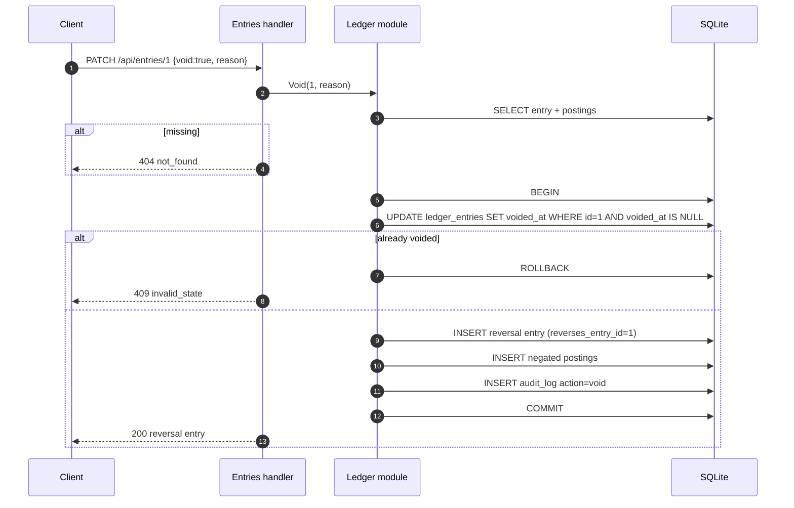

---

## 10. `GET /api/captures`

**Purpose.** The review queue: everything unconfirmed, ordered so a review screen can
render top-down without sorting.

**Upstream.** Review screen, agent checking what is waiting.
**Downstream.** `Module.Captures.List` → `Repository.Sqlite.ListCaptures`; each row's
`raw_text`, `draft_json` and `resolution_note` are unsealed before returning.

**Query params**

| name | type | default | notes |
| --- | --- | --- | --- |
| `status` | string | all | `extracting`, `pending`, `duplicate`, `approved`, `rejected`, `failed` |
| `cursor` | int | — | `id < cursor` |
| `limit` | int | 50 | clamped to 200 |

Ordering: `extracting` first, then `pending` oldest-first, then the resolved tail.

**200** `{"captures":[{"id":1,"kind":"share","status":"pending","raw_text":"…","received_at":"…"}],"next_cursor":0}`

**Errors.** `400 invalid_cursor` / `400 invalid_limit`.

**Limitations.** No `batch_id` filter yet; no unread counts; a payload sealed with a
previous `APP_SECRET` cannot be opened, so those fields come back empty rather than
failing the listing.

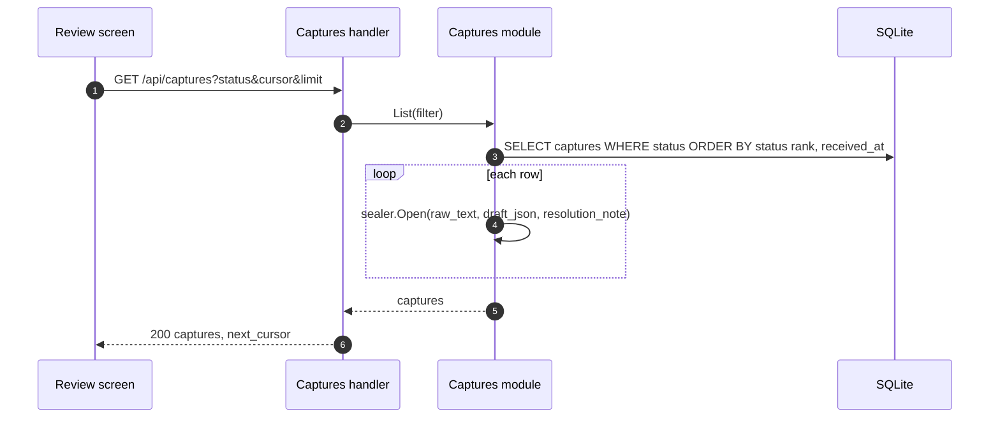

---

## 11. `POST /api/captures`

**Purpose.** Park something unconfirmed. Nothing reaches the ledger until it is
approved. Accepts JSON text or a multipart upload.

**Upstream.** PWA share target, Shortcut, agent dumping a receipt, email poller (later).
**Downstream.** `Module.Captures.Create`: dedupe key `sha256(kind|client_id|artifact_hash|raw_text)`,
seal the payload, insert the row, then — when `SNAPTOJSON_API_KEY` is set — submit the
file to the configured rail (`Repository.Snaptojson.Posting` or
`Repository.OpenAI.Posting`) and store the answer, tagged with `extraction_rail`.

**Body (JSON)**

| field | type | required | notes |
| --- | --- | --- | --- |
| `client_id` | string | no | part of the dedupe key |
| `kind` | string | yes | `share`, `image`, `email`, `statement`, `recurring`, `manual` |
| `raw_text` | string | no | sealed before storage |
| `batch_id` | string | no | groups a statement import |

**Body (multipart/form-data)**: `file` (≤ 10 MiB, the vendor's limit), plus optional
`kind` (defaults `image`), `raw_text`, `batch_id`, `client_id`. The file is hashed
(`sha256`) and handed to the vendor once; the bytes are not stored yet.

**202** created (`status` `pending`, or `extracting` when a submit answered 202),
**200** when the same payload arrived before.

**Errors.** `422 unknown_capture_kind`; `400 invalid_json` (malformed body); `422
invalid_request` (multipart body without a `file` part); `413`-class failures from the
vendor are recorded on the row, not raised.

**Limitations.** No PDF/statements support yet (the vendor reads images today); no
`raw/` artifact storage, so a 202 is polled by `job_ref` and the bytes are gone; the
completeness gate is not implemented.

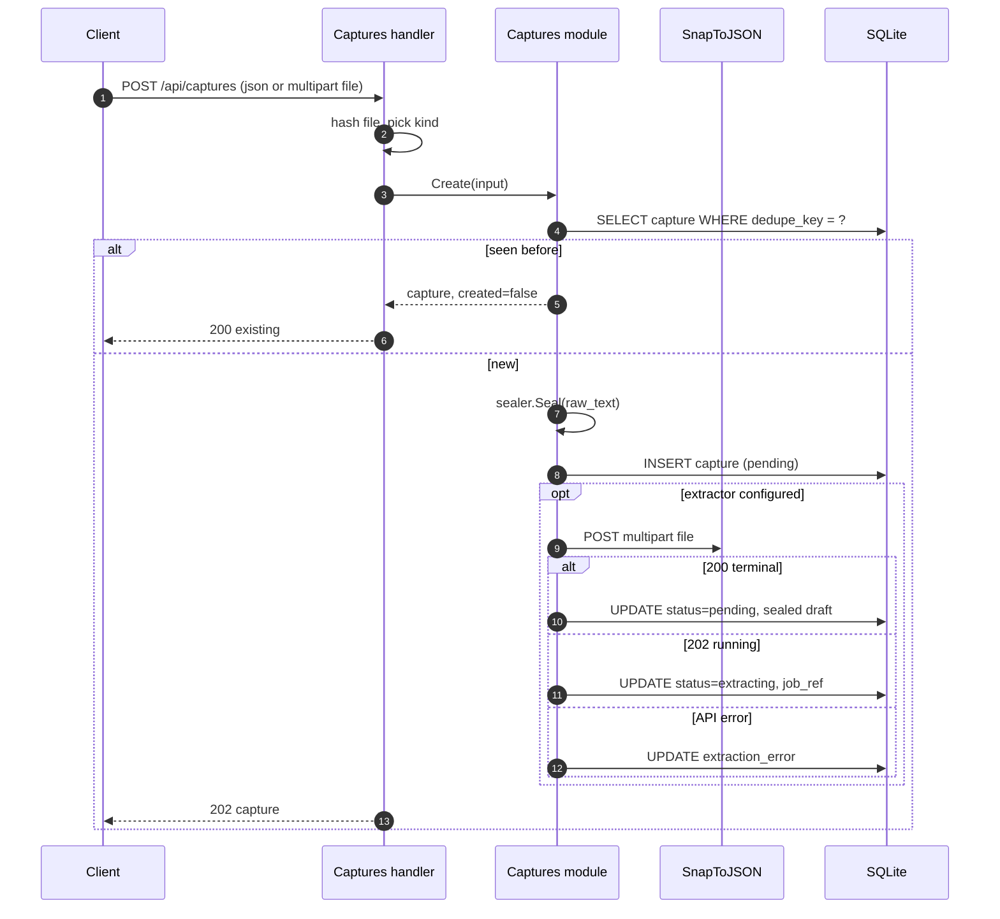

---

## 12. `PATCH /api/captures/{id}`

**Purpose.** Resolve a queue item: **approve** (post to the ledger), **reject** (out of
the queue, ledger untouched), or **retry** (read the vendor's answer back).

**Upstream.** Review screen; the vendor reading a snap back.
**Downstream.** `approve` → `Module.Ledger.Post` then `UpdateCapture`;
`reject` → sealed reason + `UpdateCapture`; `retry` → `Repository.Snaptojson.Polling`
(a single-shot rail such as OpenAI answers `409 invalid_state`)
then map the report onto the row.

**Path params.** `id` (int, required).

**Body**

| `action` | other fields | result |
| --- | --- | --- |
| `approve` | `occurred_on`, `currency`, `postings[]`, optional `payee_id`, `note` | posts an entry, resolves the capture |
| `reject` | `reason` | `status":"rejected"`, `resolution_note` sealed |
| `retry` | — | reads `job_ref` back; `pending`, `extracting` or `failed` |

Posting shape is identical to `POST /api/entries`.

**201** on approve: `{"entry":{…},"capture":{…}}`; **200** on reject/retry: the capture.

**Errors.** `404 not_found`; `409 capture_resolved` (already approved/rejected);
`422 invalid_request` (`action` not `approve|reject|retry`, bad date/amount,
postings_not_balanced` and friends from the ledger; `401 unauthorized`…
`ErrNotConfigured`-style vendor gaps surface as `422`/`500` per `classify`.

**Limitations.** `match` (link to an existing entry) and `extracted` (provider pushes a
draft) are not implemented. A capture whose vendor submit failed keeps
`extraction_error`; retry needs a `job_ref`, so a never-submitted capture answers
`409 invalid_state`.

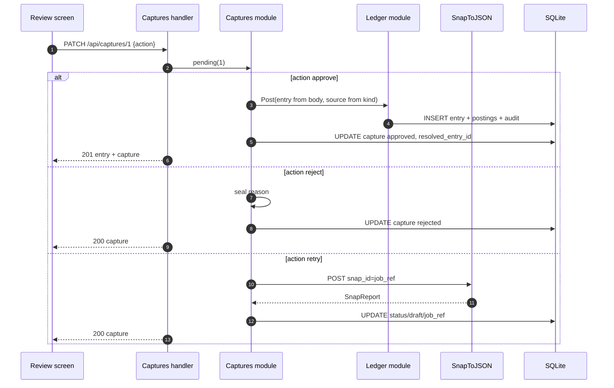

---

## Planned, not implemented

Designed in [`v2-api.md`](./v2-api.md), no handler yet. Listed so nobody guesses:

| method | path | purpose | would touch |
| --- | --- | --- | --- |
| `POST` | `/api/setup` | wizard: currency, first account, opening balance | settings, accounts, ledger |
| `POST` | `/api/accounts` | create account or category, optional opening balance | accounts, ledger, audit |
| `PATCH` | `/api/accounts/{id}` | rename, icon, reparent, archive | accounts, audit |
| `POST` | `/api/payees` | create payee | payees, audit |
| `PATCH` | `/api/payees/{id}` | rename, defaults, archive | payees, audit |
| `POST` | `/api/recurring` | create a rule, or promote an entry | recurring_rules, captures |
| `PATCH` | `/api/recurring/{id}` | accept, pause, end, edit | recurring_rules, audit |
| `GET` | `/api/months/{year_month}` | derived month report and adjustment body | ledger, captures, FX |
| `GET` | `/api/dashboard` | five tiles in one response | ledger, recurring, captures |
| `POST` | `/api/tokens` | mint a scoped API token, secret shown once | api_tokens, settings |
| `PATCH` | `/api/tokens/{id}` | revoke | api_tokens, audit |

Until they land, an agent should treat them as "not yet" — never as "read the database
directly".
