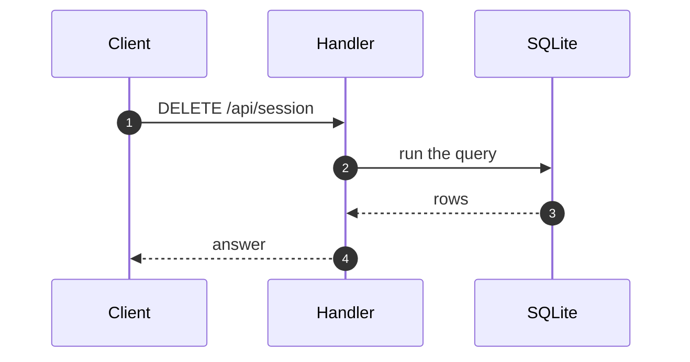

# DELETE /api/session

**Auth.** None: the route answers without a password.

## Purpose

Sign out: clear the cookie. Works in open mode too, so a client can always
reset its own state.

## Upstream

Sign-out button.

## Downstream

Nothing — the cookie is a digest of state that lives in `settings`.

## Path / query params

None.

## Body

None.

## Response

`{"status":"signed_out"}` + `Set-Cookie: spenicle_session=; Max-Age=0`

## Errors

None. The route is exempt from the session check, like `POST /api/session`.

## Limitations

Stateless: it forgets the browser's copy and nothing else. Sessions
are not listed anywhere, and one cookie class serves the whole instance.

---

## Sequence

