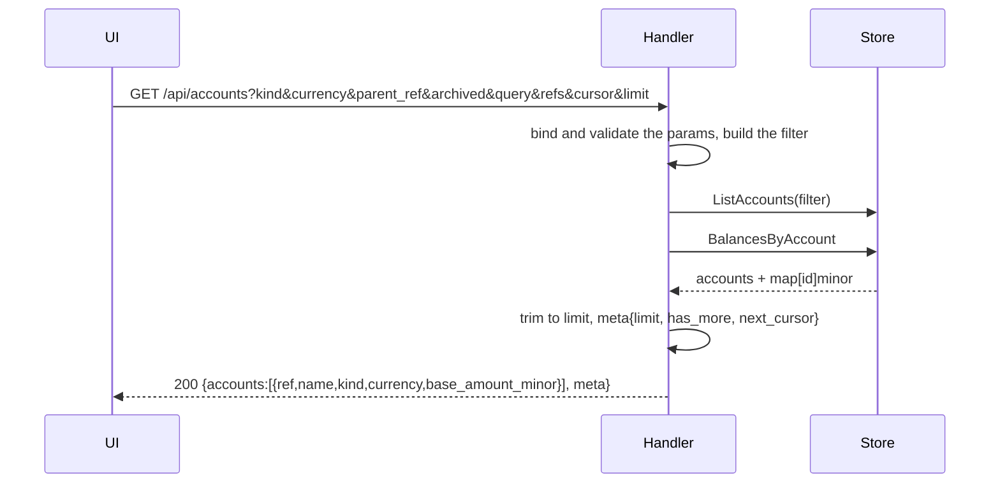

# GET /api/accounts

**Auth.** Session cookie (`spenicle_session`). Open mode passes everything through; with a password set, a missing or stale cookie is `401 unauthorized`.

## Purpose

List every account and category with the balance the ledger implies, so a screen can render a picker or a balance column without a second call and without joining refs itself.

## Upstream

Account picker on the entry form, balances panel, the ledger screen's account filter, `skills/ai-integration`.

## Downstream

`Repository.Sqlite.ListAccounts` + `Repository.Sqlite.BalancesByAccount` (sum of `ledger_postings` per account, voids excluded by their reversal). The handler joins them; no stored balance column exists.

## Path / query params

| name | type | default | notes |
| --- | --- | --- | --- |
| `kind` | string | all | `asset`, `liability`, `expense`, `income` |
| `currency` | string | all | ISO 4217 of the account |
| `parent_ref` | ref | all | children of that account |
| `archived` | bool | all | `true` only archived, `false` only live |
| `query` | string | — | substring of the account name |
| `refs` | string | — | comma-separated account refs |
| `cursor` | ref | — | accounts after the one with that ref, in `kind, name` order |
| `limit` | int | 50 | clamped to 200 |

## Body

None.

## Response

`{"accounts":[{"ref":"<32 hex>","name":"Cash","kind":"asset","currency":"IDR","base_amount_minor":"-1500","archived":false}],"meta":{"limit":50,"has_more":false,"next_cursor":"<32 hex>"}}`

`base_amount_minor` is a signed string of minor units in the base currency; negative means the account owes. `meta` is the block every list route answers: `limit` is the clamped page size, `has_more` is exact (the store fetches `limit + 1`, the handler trims) and `next_cursor` is the `ref` of the last returned account, omitted on an empty page.

## Errors

`500 internal_error` with the generic message `internal error`; the cause is logged, never returned.

## Limitations

Paged like every list, but a personal ledger never needs the second page: the default 50 covers it. Per-pair balances (native currency) are not exposed yet — only the base amount. `query` matches the name only.

## Sequence

