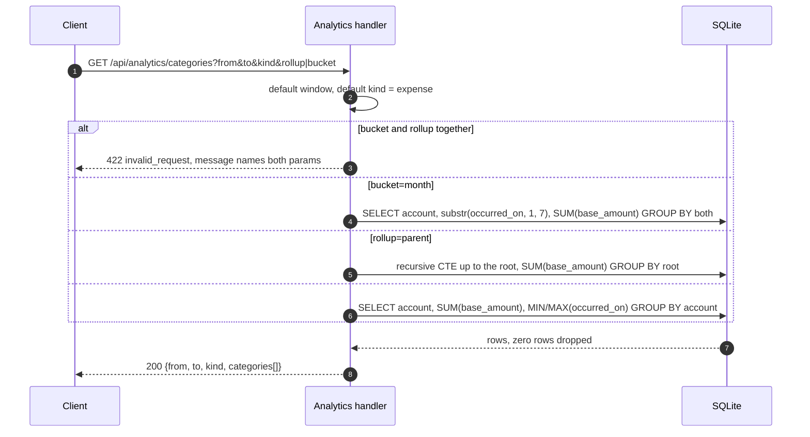

# GET /api/analytics/categories

**Auth.** `Authorization: Bearer <credential>`: the instance password, or a token carrying this route's scope. Open mode passes everything through; with a password set, a missing or wrong credential is `401 unauthorized`, and a token without the scope is `403 forbidden`.

## Purpose

The pie namespace: how much each category account moved in a range. Same date filter as
`/api/analytics/months`, different grouping — accounts instead of calendar months.

## Upstream

The category chart, the dashboard's "top category" tile, an agent summarising a month.

## Downstream

`Repository.Sqlite.CategoryTotals`: one grouped query over postings joined to entries and
accounts, filtered by `kind`, voided entries and reversals excluded, carrying the earliest
and the latest `occurred_on` of the rows behind each total. With
`rollup=parent` the handler calls `Repository.Sqlite.CategoryTotalsByRoot` instead, which
walks every account up to its top-most ancestor in a recursive CTE and groups by that
root, so a child's amount lands on its root and the children drop out of the answer. With
`bucket=month` it calls `Repository.Sqlite.CategoryTotalsByMonth`, which groups by account
and `substr(occurred_on, 1, 7)` in one pass and folds the rows into one entry per account.

## Path / query params

| name | type | required | notes |
| --- | --- | --- | --- |
| `from` | string | no | `YYYY-MM-DD` or `YYYY-MM-DDTHH:MM` (`:SS`, or full RFC3339), read in `APP_TIMEZONE`; defaults to the first of the month 11 months before `to` |
| `to` | string | no | `YYYY-MM-DD` or `YYYY-MM-DDTHH:MM` (`:SS`, or full RFC3339), read in `APP_TIMEZONE`; defaults to today *there* |
| `kind` | string | no | `expense` (default) or `income` |
| `rollup` | string | no | `parent` sums each child into its top-most ancestor and lists only roots; absent keeps one row per account |
| `bucket` | string | no | `month` answers one entry per account carrying a `months` array instead of one `amount_minor`; cannot be combined with `rollup` |

## Body

None.

## Response

**200** `{"from":"2026-02-01","to":"2026-02-28","kind":"expense","categories":[{"account_ref":"…","account_name":"Unsorted","amount_minor":"25000","first_occurred_on":"2025-06-14","last_occurred_on":"2026-02-27"}]}`

Ordered by amount, descending; categories that net to zero are dropped. With
`rollup=parent` every `account_ref` is a root and `amount_minor` is the sum of the whole
subtree; without the flag the body is byte-identical to a build that has no hierarchy.
`first_occurred_on` and `last_occurred_on` are the earliest and the latest day behind that
total, `YYYY-MM-DD`, and both are omitted when the category has no row in the window.

With `bucket=month` the body carries a different shape:
`{"from":"2026-01-01","to":"2026-02-28","kind":"expense","bucket":"month","categories":[{"account_ref":"…","account_name":"Unsorted","months":[{"month":"2026-01","spend_minor":"25000"}]}]}`

One entry per account, ordered by account name, months ascending; a month that nets to
zero is dropped, and an empty window answers `"categories":[]`.

## Errors

`422 invalid_request` for a malformed date, a `from` after `to`, a `kind` outside the two, a `rollup` other
than `parent`, a `bucket` other than `month`, or `bucket` combined with `rollup` — the
message names both params, because the shapes are exclusive.

## Limitations

Roll-up is one level of nesting in the answer, not in the data: a grandchild still lands
on the same root. `bucket=month` groups accounts directly, so it answers the accounts and
not the roots and refuses `rollup` instead of guessing. No currency conversion in either
grouping — the number is always base-currency minor units.

## Sequence

