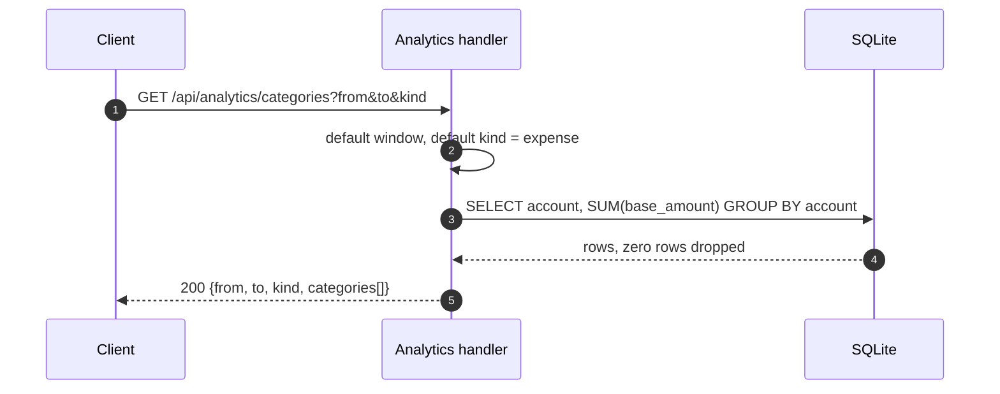

# GET /api/analytics/categories

**Auth.** `Authorization: Bearer <credential>`: the instance password, or a token carrying this route's scope. Open mode passes everything through; with a password set, a missing or wrong credential is `401 unauthorized`, and a token without the scope is `403 forbidden`.

## Purpose

The pie namespace: how much each category account moved in a range. Same date filter as
`/api/analytics/months`, different grouping — accounts instead of calendar months.

## Upstream

The category chart, the dashboard's "top category" tile, an agent summarising a month.

## Downstream

`Repository.Sqlite.CategoryTotals`: one grouped query over postings joined to entries and
accounts, filtered by `kind`, voided entries and reversals excluded.

## Path / query params

| name | type | required | notes |
| --- | --- | --- | --- |
| `from` | string | no | `YYYY-MM-DD`; defaults to 11 months back, first of month |
| `to` | string | no | `YYYY-MM-DD`; defaults to today |
| `kind` | string | no | `expense` (default) or `income` |

## Body

None.

## Response

**200** `{"from":"2026-02-01","to":"2026-02-28","kind":"expense","categories":[{"account_ref":"…","account_name":"Unsorted","amount_minor":"25000"}]}`

Ordered by amount, descending; categories that net to zero are dropped.

## Errors

`422 invalid_request` for a malformed date or a `kind` outside the two.

## Limitations

No parent roll-up yet: a child category reports alone, not under its parent. No currency
conversion in the grouping — the number is always base-currency minor units.

## Sequence

