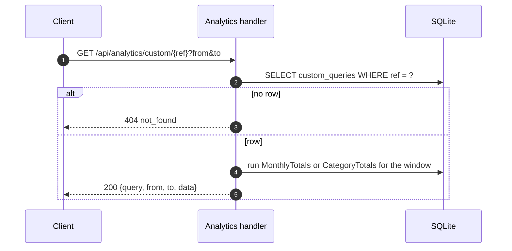

# GET /api/analytics/custom/{ref}

**Auth.** `Authorization: Bearer <credential>`: the instance password, or a token carrying this route's scope. Open mode passes everything through; with a password set, a missing or wrong credential is `401 unauthorized`, and a token without the scope is `403 forbidden`.

## Purpose

Run a saved view: the same date filter as every analytics namespace, resolved through the
stored `namespace`. The response always echoes the saved query, so a client can render
the chart type it asked for without a second call.

## Upstream

Opening a pinned chart, a dashboard embedding a saved view.

## Downstream

`CustomQueryByRef` for the spec, then `MonthlyTotals` or `CategoryTotals` for the data.

## Path / query params

| name | type | required | notes |
| --- | --- | --- | --- |
| `ref` | string | yes | path: the saved query |
| `from` | string | no | `YYYY-MM-DD`; defaults to 11 months back |
| `to` | string | no | `YYYY-MM-DD`; defaults to today |

## Body

None.

## Response

**200** `{"query":{…same shape as POST…},"from":"…","to":"…","months":[…]}` for a
`months` view, or `…,"categories":[…]` for a `categories` view. Both lists carry
`omitempty`: a view whose window holds no rows omits the key entirely instead of sending
`[]`.

## Errors

`404 not_found` for an unknown ref; `422 invalid_request` for a malformed date.

## Limitations

Only the two namespaces exist, and `categories` views always ask for `expense` — an
income pie needs its own view once the namespace learns a parameter. No caching: every
call re-runs the query.

## Sequence

