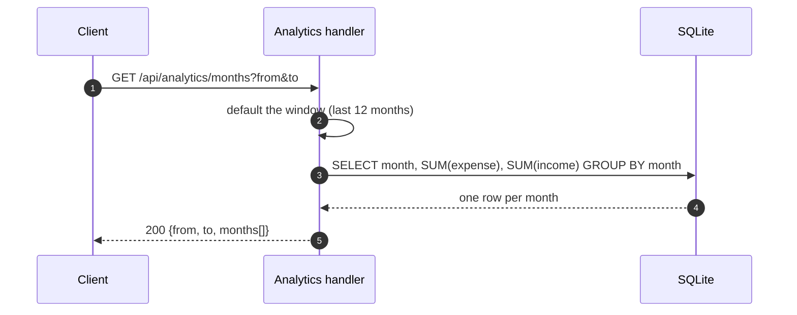

# GET /api/analytics/months

**Auth.** `Authorization: Bearer <credential>`: the instance password, or a token carrying this route's scope. Open mode passes everything through; with a password set, a missing or wrong credential is `401 unauthorized`, and a token without the scope is `403 forbidden`.

## Purpose

The first namespace of the analytics family: expense and income per calendar month,
derived from postings. It answers "how did each month go" for a timeseries or a bar
chart; nothing is stored per month, so a correction moves the number automatically.

## Upstream

The charts screen, the month list, an agent summarising the year.

## Downstream

`Repository.Sqlite.MonthlyTotals`: one grouped query over `ledger_postings` joined to
`ledger_entries` and `accounts`. Voided entries and their reversal entries are both
excluded, so a void leaves no trace.

## Path / query params

| name | type | required | notes |
| --- | --- | --- | --- |
| `from` | string | no | `YYYY-MM-DD`; defaults to the first of the month 11 months before `to`, so the default answer is the 12 buckets ending with `to`'s month |
| `to` | string | no | `YYYY-MM-DD`; defaults to today |

## Body

None.

## Response

**200**

```json
{"from":"2026-01-01","to":"2026-02-28","months":[
  {"month":"2026-01","spend_minor":"10000","income_minor":"0","net_minor":"-10000"}
]}
```

`spend_minor` sums `base_amount_minor` on `expense` accounts, `income_minor` negates it
on `income` accounts, `net_minor` is income minus spend. All are strings: money never
travels as a float.

## Errors

`422 invalid_request` for a malformed `from`/`to`, or when `from` is after `to`.

## Limitations

No timezone or fiscal-month offset (months are calendar months in the entry's date).
No breakdown by category yet — that is the next namespace (`/api/analytics/categories`).
An unbounded range is allowed; the default window is 12 months.

## Sequence


