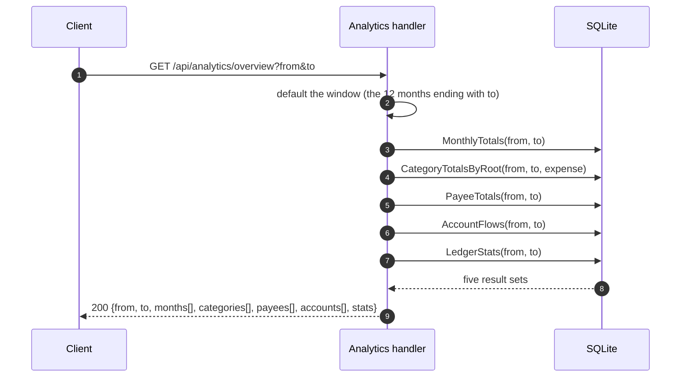

# GET /api/analytics/overview

**Auth.** `Authorization: Bearer <credential>`: the instance password, or a token carrying this route's scope. Open mode passes everything through; with a password set, a missing or wrong credential is `401 unauthorized`, and a token without the scope is `403 forbidden`.

## Purpose

The whole brief, once: the month series, the category roots and payees on **both** sides of the
ledger, the money accounts and two stats, in one response and one round trip. Every block is also readable route by
route — `/api/analytics/months` and `/api/analytics/categories` still answer — but a screen
that draws all five should not make four calls to draw one page.

## Upstream

The analytics screen: the twelve-month brief, an agent summarising a year, a report that
wants the shape of the ledger without walking entries.

## Downstream

Seven reads over the same window, each one grouped query over `postings` joined to `entries`
and `accounts`, with reversed entries and reversals excluded from all of them:

- `Repository.Sqlite.MonthlyTotals` — spend and income per calendar month, zero-filled.
- `Repository.Sqlite.CategoryTotalsByRoot` — expense rolled up to the top-most ancestor.
- `Repository.Sqlite.CategoryTotalsByRoot` again with `income`, for where the money came from.
- `Repository.Sqlite.PayeeTotals` — `expense` or `income`, grouped by `entries.payee_ref`, named
  through a left join, so the spend that named nobody arrives as a row with no `payee_ref`.
  It runs twice: who was paid, and who paid you.
- `Repository.Sqlite.AccountFlows` — per `asset` and `liability` account, the positive and
  negative postings summed apart, so inflow and outflow are magnitudes and `net_minor`
  keeps the ledger's sign. Expense and income accounts are what the money was for, not
  where it sat, so they are out of the flow on purpose.
- `Repository.Sqlite.LedgerStats` — the count of entries in the window, and the day the
  most money left, both over the same exclusions.

## Path / query params

| name | type | required | notes |
| --- | --- | --- | --- |
| `from` | string | no | `YYYY-MM-DD` or `YYYY-MM-DDTHH:MM` (`:SS`, or full RFC3339), read in `APP_TIMEZONE`; defaults to the first of the month 11 months before `to` |
| `to` | string | no | the same shapes, read in `APP_TIMEZONE`; defaults to today *there* |

## Body

None.

## Response

**200**

```json
{"from":"2026-01-01","to":"2026-02-28",
 "months":[{"month":"2026-01","spend_minor":"10000","income_minor":"0","net_minor":"-10000"}],
 "categories":[{"account_ref":"<32 hex>","account_name":"Food","amount_minor":"10000",
                "first_occurred_on":"2026-01-10","last_occurred_on":"2026-01-10"}],
 "payees":[{"payee_ref":"<32 hex>","payee_name":"Corner shop","amount_minor":"10000"}],
 "accounts":[{"account_ref":"<32 hex>","account_name":"Cash","kind":"asset",
              "inflow_minor":"50000","outflow_minor":"10000","net_minor":"40000"}],
 "stats":{"entries":2,"busiest_on":"2026-01-10","busiest_spend_minor":"10000"},
 "income_categories":[{"account_ref":"<32 hex>","account_name":"Salary","amount_minor":"50000",
                       "first_occurred_on":"2026-02-11","last_occurred_on":"2026-02-11"}],
 "income_payees":[{"payee_ref":"<32 hex>","payee_name":"Employer","amount_minor":"50000"}]}
```

Every amount is minor units as a string. `months` carries every calendar month in the
window, empty ones included, because a chart needs a slot per month. `categories` is ordered
by amount descending and drops the categories that net to zero; `payees` is ordered the same
way, and its unnamed row omits both `payee_ref` and `payee_name` — the screen says "no payee"
in its own words. `accounts` carries one row per money account that moved, ordered by net
descending. `income_categories` and `income_payees` mirror the two spend blocks on the other side
of the ledger, and their amounts are **magnitudes**: income postings are credits, so the store
returns them negative and the handler negates them, because "received 50,000" is what a person
means. `/api/analytics/categories?kind=income` still answers the raw credit sign — this route is
the one that spells it out. `busiest_on` and `busiest_spend_minor` are omitted when nothing was spent in the
window; `entries` is `0` then, not omitted.

## Errors

- `422 invalid_request` — a malformed `from` or `to`, or a `from` after `to`. The message
  names the parameter, because the shapes are validated by the same rule the rest of the
  analytics family uses.
- `500 internal_error` — one of the five reads failed; the cause is logged, never sent.

## Limitations

Seven queries, not one statement: each one is a different grouping, and SQLite cannot pivot
them into a single scan without making the plan worse. They run in sequence on one
connection, which is fine for one household and would not be for many.
There is no cache: the numbers are derived from `postings` on every call, so a correction
moves the answer immediately.
`categories` and `income_categories` are rolled up to the top-most ancestor; the per-child and
per-month shapes stay on `/api/analytics/categories`.
`accounts` is `asset` and `liability` only, so `equity` postings — opening balances — do not
appear in the flow.

## Sequence


