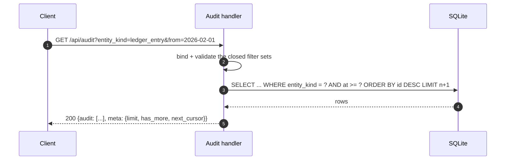

# GET /api/audit

**Auth.** Session cookie, or a token carrying `audit:read`.

## Purpose

Read the journal: one append-only row per state change, newest first.

## Upstream

The audit screen, an operator asking "who voided this entry", a script diffing a backup.

## Downstream

`Module`-free: `Repository.Sqlite.ListAudit` under one span, one `WHERE` per filter, cursor
on `audit_log.id`. Rows are never written here.

## Path / query params

| param | notes |
| --- | --- |
| `entity_kind` | `account`, `payee`, `recurring_rule`, `ledger_entry`, `capture`, `setting`, `api_token` |
| `entity_ref` | the row's ref; a `setting` has none (its key is in `to.key`) |
| `action` | `create`, `update`, `void`, `approve`, `reject`, `retry`, `advance`, `generate`, `revoke` |
| `actor_kind` | `user`, `token`, `worker`, `system` |
| `from`, `to` | `YYYY-MM-DD`, inclusive |
| `cursor`, `limit` | the shared paging (default 50, max 200) |

## Body

None.

## Response

`200` with the list envelope: `{"audit": [...], "meta": {...}}`. Each row carries `ref`,
`entity_kind`, `entity_ref`, `action`, `actor_kind`, `actor_ref`, `from` and `to` as JSON
objects (omitted when the change had no payload) and `at`.

## Errors

`422 invalid_request` for a malformed date, an unknown kind, action or actor kind (the
filter table is a closed set), `400 invalid_request` for a non-ref cursor.

## Limitations

Read-only: there is no route that edits or deletes a journal row, and none that appends one
by hand. The journal does not include import/export job steps (their own
`import_events`/`export_events` are the record) or artifact rows.

## Sequence

