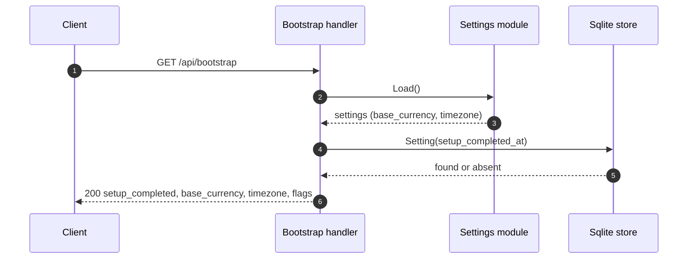

# GET /api/bootstrap

**Auth.** None. This is a public route in the public mux: no `Authorization` header is read and no credential is resolved.

## Purpose

The one read a client needs before it holds a credential: it says whether the instance
has been claimed yet. `false` means the setup screen, `true` means the sign-in screen.

## Upstream

The first screen of a fresh instance, and any client that wants to know which mode the
instance is in before it asks for a password.

## Downstream

`Module.Settings.Load` → the sealed `settings` row (its base currency, and whether a password
is stored), and `Repository.Sqlite.Setting` → the `setup_completed_at` row. `claimable` is the
negation of that password check — the same predicate the identity middleware uses to decide
whether the instance is still open. No account, no entry, no payee and no secret is read.

## Path / query params

None.

## Body

None.

## Response

`{"setup_completed":false,"claimable":true,"base_currency":"IDR","timezone":"UTC","extraction_enabled":false,"ai_assistance":false}`

## Errors

`500 internal_error` when the settings row or the `setup_completed_at` row cannot be
read; the body is the generic message and the cause goes to the log.

## Limitations

It is a mode, not a secret, and it is deliberately narrow: no account, no amount, no
credential. `claimable: true` also means the instance is **open** — a fresh database has no
password until [`POST /api/setup`](./POST_api_setup.md) sets one, so anyone who can reach the
port can claim it. That window is documented, not hidden: start the container on a trusted
network or claim it before exposing the port.
Two booleans, and they answer different questions. `setup_completed` reports the
`setup_completed_at` marker itself — whether `POST /api/setup` finished — so an instance
claimed by an earlier build reads `false` there even though it carries a password.
`claimable` is the one a client acts on: `false` the moment a password exists, because that
is when the identity middleware stops treating every request as the root credential. A
client picks the claim screen on `claimable: true`, not on `setup_completed`. `base_currency`
before setup is the default (`IDR`), so a client must not treat it as the chosen one while
`setup_completed` is `false`.

---

## Sequence

