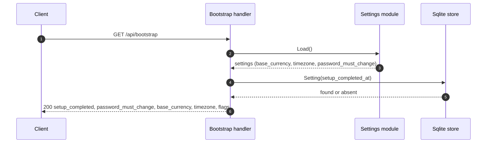

# GET /api/bootstrap

**Auth.** None. This is a public route in the public mux: no `Authorization` header is read, no credential is resolved, and the gate that forces the password change does not apply to it. It answers in open mode, in gate mode and in normal mode alike.

## Purpose

The one read a client needs before it holds a credential: it says whether the ledger is
opened yet and whether the password is still the one the boot generated.

## Upstream

The first screen of a fresh instance, and any client that wants to know which mode the
instance is in before it asks for a password.

## Downstream

`Module.Settings.Load` → the sealed `settings` row, and `Repository.Sqlite.Setting` → the
`setup_completed_at` row. No account, no entry, no payee and no secret is read.

## Path / query params

None.

## Body

None.

## Response

`{"setup_completed":false,"password_must_change":true,"base_currency":"IDR","timezone":"UTC","extraction_enabled":false,"ai_assistance":false}`

## Errors

`500 internal_error` when the settings row or the `setup_completed_at` row cannot be
read; the body is the generic message and the cause goes to the log.

## Limitations

It is a mode, not a secret, and it is deliberately narrow: there is no account count, no
ledger size and no credential here, so a scanner learns only what `/healthz` already
publishes plus the two mode flags. `password_must_change` is the gate, not the password:
a client still needs the generated password (written to `./data/first-boot.txt` at the
first boot) to open it, and `setup_completed` is `false` on a database that has entries
but never completed `POST /api/setup` — a legacy instance, whose base currency is locked
anyway. `base_currency` before setup is the default (`IDR`), so a client must not treat it
as the chosen one when `setup_completed` is `false`.

---

## Sequence

