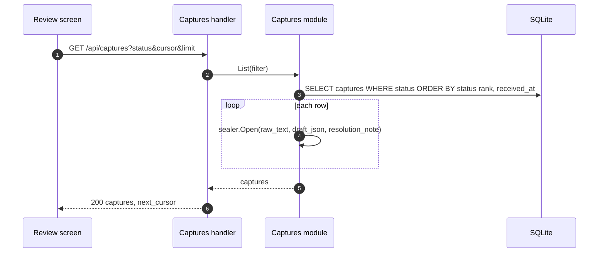

# GET /api/captures

**Auth.** Session cookie (`spenicle_session`). Open mode passes everything through; with a password set, a missing or stale cookie is `401 unauthorized`.

## Purpose

The review queue: everything unconfirmed, ordered so a review screen can
render top-down without sorting.

## Upstream

Review screen, agent checking what is waiting.

## Downstream

`Module.Captures.List` → `Repository.Sqlite.ListCaptures`; each row's
`raw_text`, `draft_json` and `resolution_note` are unsealed before returning. Each row
also carries its provenance: `extraction_rail` (who read it), `extraction_model` (with
which model) and `job_ref` (the vendor's handle on that run).

## Path / query params

| name | type | default | notes |
| --- | --- | --- | --- |
| `status` | string | all | `extracting`, `pending`, `duplicate`, `approved`, `rejected`, `failed` |
| `cursor` | int | — | `id < cursor` |
| `limit` | int | 50 | clamped to 200 |

Ordering: `extracting` first, then `pending` oldest-first, then the resolved tail.

## Body

None.

## Response

`{"captures":[{"ref":1,"kind":"share","status":"pending","raw_text":"…","received_at":"…"}],"next_cursor":0}`

## Errors

`422 invalid_request` for an unknown `status`, a negative `cursor` or a
`limit` over 200.

## Limitations

No `batch_id` filter yet; no unread counts; a payload sealed with a
previous `APP_SECRET` cannot be opened, so those fields come back empty rather than
failing the listing.

---

## Sequence

