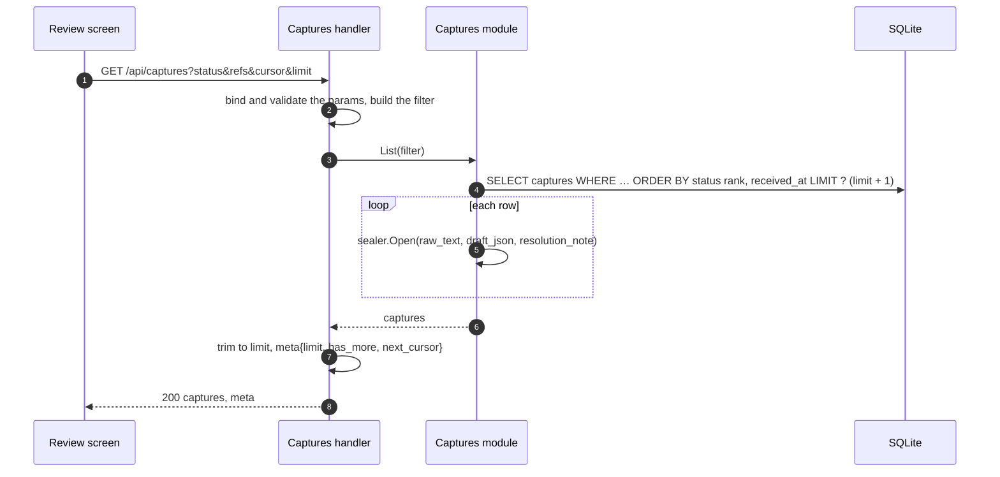

# GET /api/captures

**Auth.** `Authorization: Bearer <credential>`: the instance password, or a token carrying this route's scope. Open mode passes everything through; with a password set, a missing or wrong credential is `401 unauthorized`, and a token without the scope is `403 forbidden`.

## Purpose

The review queue: everything unconfirmed, ordered so a review screen can
render top-down without sorting.

## Upstream

Review screen, agent checking what is waiting.

## Downstream

`Module.Captures.List` → `Repository.Sqlite.ListCaptures`; each row's
`raw_text`, `draft_json` and `resolution_note` are unsealed before returning. Each row
also carries its provenance: `extraction_rail` (who read it), `extraction_model` (with
which model) and `job_ref` (the vendor's handle on that run).

## Path / query params

| name | type | default | notes |
| --- | --- | --- | --- |

| `status` | string | all | `extracting`, `pending`, `duplicate`, `approved`, `rejected`, `failed` |
| `refs` | string | — | comma-separated capture refs |
| `cursor` | ref | — | `id < (SELECT id FROM captures WHERE ref = ?)` |
| `limit` | int | 50 | clamped to 200 |

Ordering: `extracting` first, then `pending` oldest-first, then the resolved tail.

## Body

None.

## Response

`{"captures":[{"ref":"<32 hex>","kind":"share","status":"pending","raw_text":"…","received_at":"…"}],"meta":{"limit":50,"has_more":false,"next_cursor":"<32 hex>"}}`

`meta` is the same block every list route answers: `limit` is the clamped page size,
`has_more` is exact (the store fetches `limit + 1` rows, the handler trims) and
`next_cursor` is the `ref` of the last returned capture, omitted on an empty page. The
cursor is a ref, never an integer id.

## Errors

`422 invalid_request` for an unknown `status`, a `refs` entry or `cursor` that is not a
32-hex ref, or a `limit` over 200.

## Limitations

No `batch_id` filter yet; no unread counts; a payload sealed with a
previous `APP_SECRET` cannot be opened, so those fields come back empty rather than
failing the listing.

---

## Sequence

