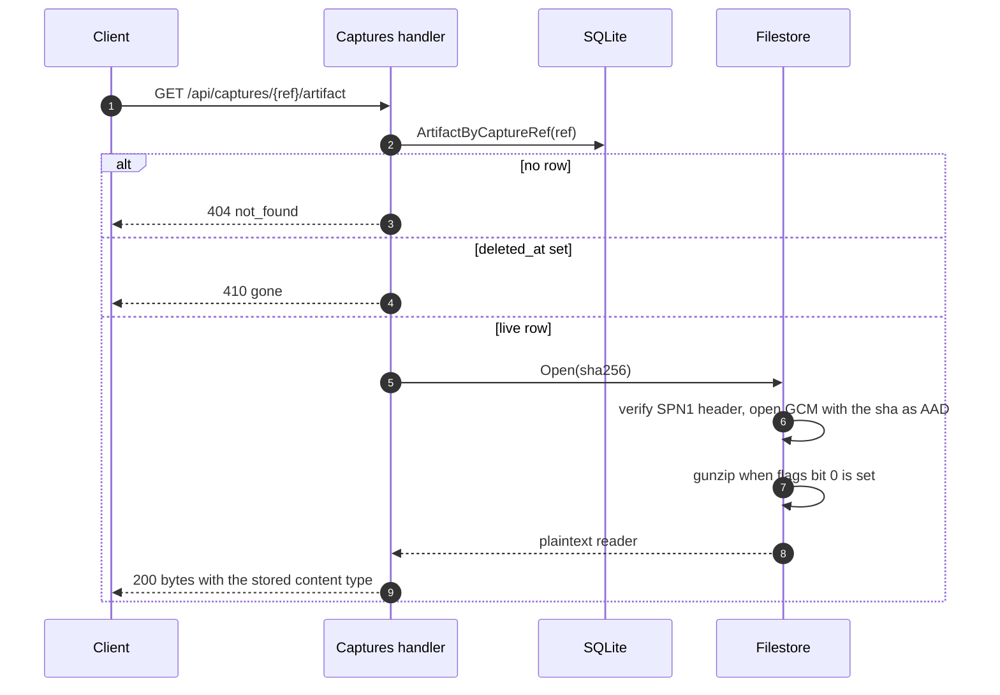

# GET /api/captures/{ref}/artifact

**Auth.** Session cookie (`spenicle_session`). Open mode passes everything through; with a password set, a missing or stale cookie is `401 unauthorized`.

## Purpose

Download the document behind a capture — the receipt, the statement, the screenshot —
byte for byte as it was uploaded, so a reviewer can read the source instead of trusting
the extracted draft.

## Upstream

The review screen and anything that keeps a local copy of a receipt.

## Downstream

`Repository.Sqlite.ArtifactByCaptureRef` for the metadata, then
`Filestore.Open` for the bytes: the file is read, authenticated (AES-256-GCM with the
plaintext sha256 as additional data), gunzipped when it was stored gzipped, and
streamed back. No vendor call, no extraction, no audit row.

## Path / query params

| name | type | required | notes |
| --- | --- | --- | --- |
| `ref` | string | yes | the capture ref, 32 hex |

## Body

None.

## Response

The plaintext bytes with the content type recorded at upload (`Content-Type`), plus:

| header | value |
| --- | --- |
| `Content-Disposition` | `attachment; filename="<uploaded name>"` |
| `X-Content-Type-Options` | `nosniff` |
| `Cache-Control` | `private, no-store` |

Not JSON, so this is the one route where the error envelope is the only JSON it ever
writes.

## Errors

| status | code | when |
| --- | --- | --- |
| `404` | `not_found` | the capture has no `artifacts` row, or the ref names no capture, or the file is gone from disk |
| `410` | `gone` | `artifacts.deleted_at` is set: the worker reclaimed the file |
| `422` | `invalid_request` | the path `ref` is not 32 lowercase hex |

## Limitations

One artifact per capture (`UNIQUE (capture_id)`) and no range requests: the whole
document is decrypted and streamed in one response. A rejected capture keeps its file
until the retention expires, after which this route answers `410 gone` — the row stays,
so the history of the capture is intact.

---

## Sequence

