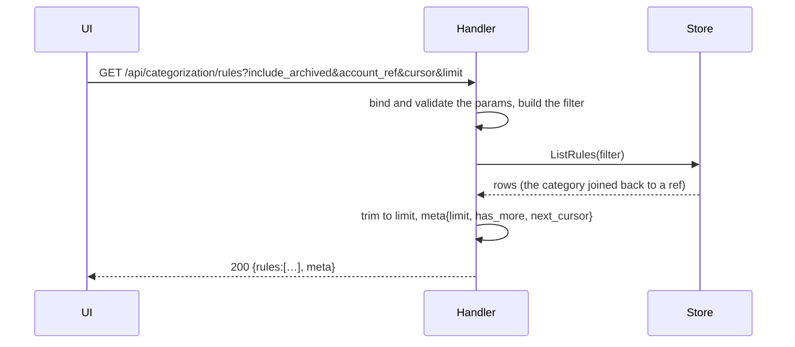

# GET /api/categorization/rules

**Auth.** `Authorization: Bearer <credential>`: the instance password, or a token carrying the `categorization:read` scope. Open mode passes everything through; with a password set, a missing or wrong credential is `401 unauthorized`, and a token without the scope is `403 forbidden`.

## Purpose

List the deterministic rules that suggest a category, oldest first by creation (id) order, so the settings screen
can show what the ledger will pre-fill and the user can retire a rule that aged badly.

## Upstream

The rules screen, a diff of "what would this statement line get" before trusting the
suggestion endpoint.

## Downstream

`Repository.Sqlite.ListRules`: one `SELECT` over `categorization_rules` joined to
`accounts` (the category comes back as a `ref`, never an id), filtered and paged by the
builder every list route shares.

## Path / query params

| name | type | default | notes |
| --- | --- | --- | --- |
| `include_archived` | bool | absent | `true` lists archived rules too, `false` or absent lists only live ones |
| `account_ref` | ref | — | only the rules that point at this category |
| `cursor` | ref | — | rules after the one with that ref, in creation order |
| `limit` | int | 50 | clamped to 200 |

## Body

None.

## Response

```json
{"rules":[{"ref":"<32 hex>","pattern":"indomaret","field":"payee","match_kind":"contains","category_ref":"<32 hex>","priority":0,"archived":false,"created_at":"<iso 8601>"}],"meta":{"limit":50,"has_more":false}}
```

`pattern` is always the stored form: trimmed and lowercased, so the caller never has to fold
case to compare two rules. `meta` is the block every list route answers — `limit` is the
clamped page size, `has_more` is exact, `next_cursor` is the `ref` of the last returned rule
and is omitted on an empty page.

## Errors

`422 invalid_request` when `account_ref` or `cursor` is not a ref, or `include_archived` is
neither `true` nor `false`; `500 internal_error` with the generic message `internal error`.

## Limitations

No full-text search over the patterns, no sort other than creation order, and archived rules
are recalled only through `include_archived`: the flag is a filter, not a status field.

## Sequence


