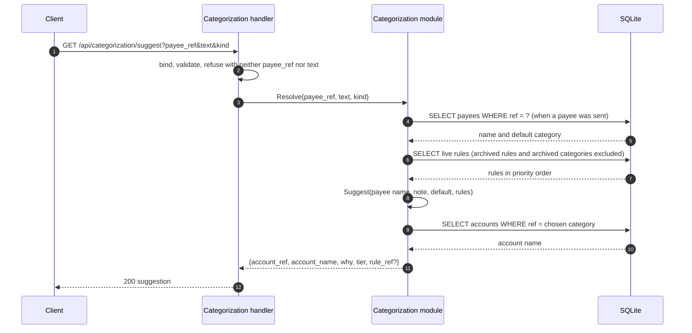

# GET /api/categorization/suggest

**Auth.** `Authorization: Bearer <credential>`: the instance password, or a token carrying the `categorization:read` scope. Open mode passes everything through; with a password set, a missing or wrong credential is `401 unauthorized`, and a token without the scope is `403 forbidden`.

## Purpose

Answer "which category would this be?" for a payee or a raw text, with the reason it was
chosen. The answer is deterministic and explainable: the payee's own default first, then the
live rules by tier and priority. It writes nothing and posts nothing.

## Upstream

The entry form pre-filling a category, the capture review screen explaining a suggestion, an
agent deciding whether it needs to ask.

## Downstream

`Module.Categorization.Resolve`: the payee (when `payee_ref` is given), the live rules
(`Repository.Sqlite.ListLiveRules`, which already drops archived rules and rules pointing at
an archived category), then the pure resolver — no I/O, no clock, no randomness.

## Path / query params

| name | type | default | notes |
| --- | --- | --- | --- |
| `payee_ref` | ref | — | the payee whose name and default category are used |
| `text` | string | — | ≤ 200 characters; the payee name to match and the note to match |
| `kind` | string | `expense` | `expense` or `income`; rules and a payee default pointing at the other kind are skipped |

Either `payee_ref` or `text` is required. With `payee_ref`, the payee's stored name is what the
rules see and `text` is the note; without it, `text` is treated as both the payee name and the
note, which is what makes a raw statement line classifiable.

## Body

None.

## Response

```json
{"account_ref":"<32 hex>","account_name":"Grocery","why":"the payee name contains \"indomaret\"","tier":"rule_contains","rule_ref":"<32 hex>"}
```

`tier` is the precedence ladder, strongest first: `payee_default`, `rule_exact`,
`rule_contains` (a `contains` or a `prefix` rule) and `none`. `rule_ref` is omitted when no
rule fired. `why` is one sentence naming the rule pattern that matched. The `none` tier still
answers the seeded `Unsorted` expense category, so the caller always has something to
pre-select.

Inside one tier the winner is the highest `priority`, then the longest `pattern`, then the
oldest `created_at` — three deterministic tie-breaks, no dependence on row order.

## Errors

`404 not_found` when `payee_ref` names no payee; `422 invalid_request` when neither `payee_ref`
nor `text` is sent, when `text` is over 200 characters, or when `kind` is not `expense` or
`income`; `500 internal_error` with the generic message `internal error`.

## Limitations

No learning, no scoring and no regex: `exact` only ever applies to the payee name, so an exact
rule on the note is stored but never fires. The suggestion is advice — `POST /api/entries`
and `PATCH /api/captures/{ref}` are still what decide the category.

## Sequence


