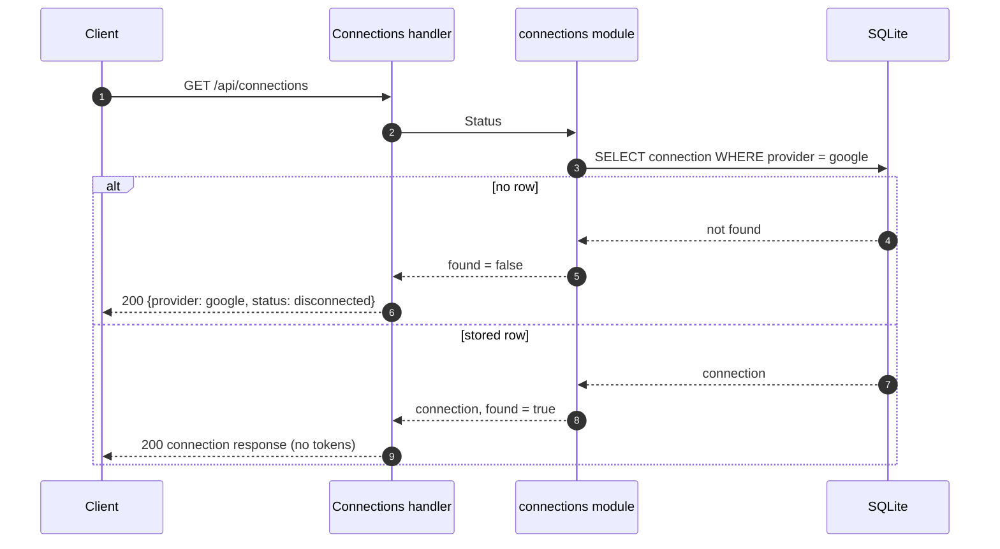

# GET /api/connections

**Auth.** Instance password only. This route lives in the root-only group: a scoped Bearer credential is refused with `403 forbidden` before the handler runs; with no password seeded, open mode passes the request through.

## Purpose

Report whether the Google mailbox connection is authorised, usable or revoked. No secrets, no client id and no refresh token leave the server.

## Upstream

The settings screen's connection panel, before showing "connect" or "revoke".

## Downstream

`Module.Connections.Status` → `Repository.Sqlite.ConnectionByProvider` for the single Google row.

## Path / query params

None.

## Body

None.

## Response

**200** when no row exists:

```json
{"provider":"google","status":"disconnected"}
```

**200** when a row exists:

```json
{"ref":"<32 hex>","provider":"google","status":"active","account":"user@example.com","scopes":["mail.read"],"access_expires_at":"2026-04-15T09:00:00Z","last_refreshed_at":"2026-04-15T08:00:00Z"}
```

`ref`, `account`, `scopes`, `access_expires_at`, `last_refreshed_at` and `revoked_at` use `omitempty`; `revoked_at` appears only after revocation. `status` is the stored state (`active`, `reauth_required`; a revoked row keeps its prior status and carries `revoked_at`).

## Errors

- `500 internal_error` — the connection row could not be read.

## Limitations

Google is the only provider wired. The status never triggers a token refresh or a provider call; use `POST /api/intake/run` to prove the grant works. An absent row and a revoked row are different answers: the first is `disconnected`, the second has a `ref` and `revoked_at`.

## Sequence


