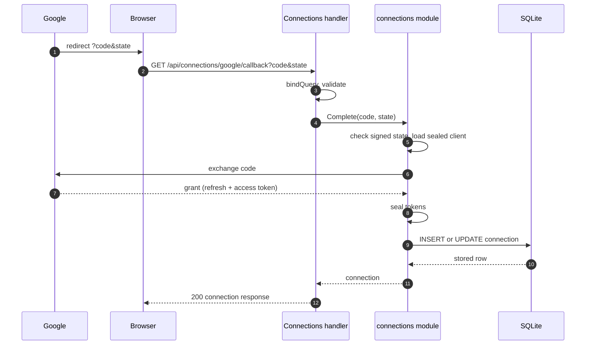

# GET /api/connections/google/callback

**Auth.** None. This route is public because Google redirects the browser here; the signed `state` returned by `POST /api/connections/google` is the forgery check and expires after 10 minutes.

## Purpose

Finish the Google grant: validate the callback state, exchange the code, store the sealed tokens and return the connection.

## Upstream

The browser redirect from Google after the user consents. The `redirect_url` sent to `POST /api/connections/google` must point here.

## Downstream

`Module.Connections.Complete`: validate `state`, load the sealed client record, exchange `code` through the Gmail adapter, seal the refresh and access tokens, then `Repository.Sqlite.SaveConnection`.

## Path / query params

| name | type | required | notes |
| --- | --- | --- | --- |
| `code` | string | yes | 1–2048 characters, supplied by Google |
| `state` | string | yes | 1–200 characters, the exact value from the start response |

## Body

None.

## Response

**200** with the same object `GET /api/connections` returns for a stored row, including `ref`, `provider`, `status`, `account`, `scopes`, `access_expires_at` and `last_refreshed_at` when present. No token is echoed.

## Errors

- `422 invalid_request` — a missing or overlong `code` or `state`, or no stored client record.
- `401 invalid_state` — the state is forged, altered or older than 10 minutes.
- `409 reauth_required` — the provider reports an expired grant.
- `500 internal_error` — the exchange failed, no refresh token came back, or sealing/storing failed.

## Limitations

The handler answers JSON; it does not redirect the browser into the app. Re-authorising keeps the first refresh token when Google omits it and unions old and new scopes. This route completes a Google grant only; no other provider callback exists.

## Sequence

