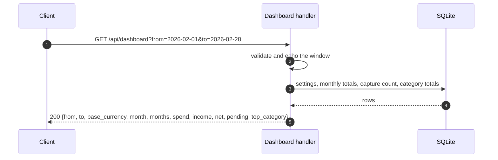

# GET /api/dashboard

**Auth.** `Authorization: Bearer <credential>`: the instance password, or a token carrying this route's scope. Open mode passes everything through; with a password set, a missing or wrong credential is `401 unauthorized`, and a token without the scope is `403 forbidden`.

## Purpose

The landing screen in one request: the newest month with data in the requested window,
its month-by-month rollup, the number of captures received in that window and still
waiting for review, and the biggest expense category in the same window. Every tile is
derived from rows, so no counter can drift.

## Upstream

The home screen on first paint. The client chooses the window; the server never guesses
one from the clock.

## Downstream

`Settings.Load` for the base currency, `MonthlyTotals(from, to)` for the month tiles,
`CaptureCount(from, to, status)` for the queue, `CategoryTotals(from, to, kind)` for the
top category.

## Path / query params

| name | type | required | meaning |
| --- | --- | --- | --- |
| `from` | `YYYY-MM-DD` | yes | first day of the window, inclusive |
| `to` | `YYYY-MM-DD` | yes | last day of the window, inclusive |

Both are required. `from` must not be after `to`, and the inclusive window must not span
more than 366 days. Dates are calendar days, not timestamps.

## Body

None.

## Response

**200**

```json
{"from":"2026-02-01","to":"2026-02-28","base_currency":"IDR","month":"2026-02",
 "spend_minor":"10000","income_minor":"0","net_minor":"-10000",
 "months":[{"month":"2026-02","spend_minor":"10000","income_minor":"0","net_minor":"-10000"}],
 "pending_captures":0,
 "top_category":{"account_ref":"…","account_name":"Unsorted","amount_minor":"10000"}}
```

`month`, `spend_minor`, `income_minor` and `net_minor` describe the newest month with data
inside the window; an empty window labels the month of `to` and answers zeroes. `months`
carries every month in the window that has data, oldest first, with the same four fields
per row. `pending_captures` counts captures with status `pending` whose `received_at` falls
in the window. `top_category` is the largest expense category in the window and is omitted
when there are no expenses.

## Errors

`422 invalid_request` when a date is missing or malformed, when `from` is after `to`, or
when the window spans more than 366 days.
`500 internal_error` for a local read failure.

## Limitations

One currency: tiles are base-currency minor units, no per-account split. The month shown
is the newest month with data in the requested window, not necessarily the current
calendar month. The window is capped at 366 days so the rollup cannot scan an unbounded
history. No caching; three analytics queries per call.

## Sequence


