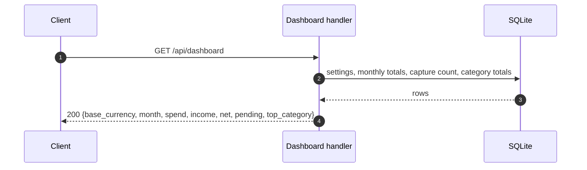

# GET /api/dashboard

**Auth.** Session cookie (`spenicle_session`). Open mode passes everything through; with a password set, a missing or stale cookie is `401 unauthorized`.

## Purpose

The landing screen in one request: this month's spend, income and net, how many captures
wait for review, and the biggest expense category of the last twelve months. Every tile
is derived from postings, so no counter can drift.

## Upstream

The home screen on first paint.

## Downstream

`Settings.Load` for the base currency, `MonthlyTotals` for the month tiles,
`CaptureCount` for the queue, `CategoryTotals` for the top category.

## Path / query params

None: the window is fixed to the last twelve months, the tiles to the newest month.

## Body

None.

## Response

**200**

```json
{"base_currency":"IDR","month":"2026-02","spend_minor":"10000","income_minor":"0",
 "net_minor":"-10000","pending_captures":0,
 "top_category":{"account_ref":"…","account_name":"Unsorted","amount_minor":"10000"}}
```

An empty ledger answers zeroes and omits `top_category`, never an error.

## Errors

`500 internal_error` only — every read is local.

## Limitations

One currency: tiles are base-currency minor units, no per-account split. The month shown
is the newest month with data, not necessarily the current calendar month. No caching;
four queries per call.

## Sequence


