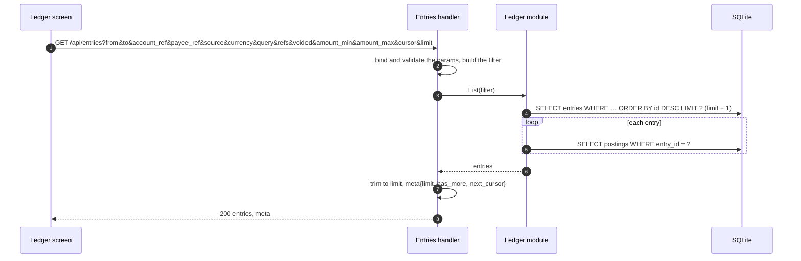

# GET /api/entries

**Auth.** `Authorization: Bearer <credential>`: the instance password, or a token carrying this route's scope. Open mode passes everything through; with a password set, a missing or wrong credential is `401 unauthorized`, and a token without the scope is `403 forbidden`.

## Purpose

Read the ledger: newest first, filtered, paged, postings included.

## Upstream

Ledger screen, agents auditing spend, `skills/ai-integration`.

## Downstream

`Module.Ledger.List` → `Repository.Sqlite.ListEntries` (one query for
entries, one per entry for its postings).

## Path / query params

| name | type | default | notes |
| --- | --- | --- | --- |
| `from` | date | — | `occurred_on >= from` |
| `to` | date | — | `occurred_on <= to` |
| `account_ref` | ref list | — | comma-separated: entries touching any of these accounts |
| `payee_ref` | ref list | — | comma-separated: entries for any of these payees |
| `source` | source list | — | comma-separated: `manual`, `share`, `email`, `statement`, `recurring`, `adjustment` |
| `currency` | string | — | ISO 4217, the entry's own currency |
| `query` | string | — | substring of the note or of the payee name |
| `refs` | ref list | — | comma-separated entry refs |
| `voided` | bool | — | `true` only voided entries, `false` only live ones, absent both |
| `amount_min` | money | — | smallest absolute posting amount to match |
| `amount_max` | money | — | largest absolute posting amount to match |
| `cursor` | ref | — | return entries older than the entry with that ref |
| `limit` | int | 50 | clamped to 200 |

Every `* list` parameter takes one value or many, separated by commas, and a repeated
member is harmless. The lists widen: `payee_ref=a,b` is "either payee", never "both".

`amount_min` and `amount_max` compare against `ABS(base_amount_minor)` of the entry's
postings in the **base currency**, and an entry matches when at least one posting falls
inside the range. So a spend of 18.000 and an income of 18.000 match the same bounds, and
`amount_min=18000&amount_max=18000` is the exact-amount lookup a bank SMS wants. An upside
down range (`min > max`) is not an error, it matches nothing.

## Body

None.

## Response

`{"entries":[{"ref":"<32 hex>","occurred_on":"2026-02-14","currency":"IDR","source":"manual","note":"coffee","payee":{"ref":"<32 hex>","name":"KOPI KENANGAN"},"postings":[{"account":{"ref":"<32 hex>","name":"Unsorted","kind":"expense"},"account_ref":"<32 hex>","amount_minor":"1500","base_amount_minor":"1500","fx_rate":"1","fx_source":"identity"}]}],"meta":{"limit":50,"has_more":false,"next_cursor":"<32 hex>"}}`

`meta.limit` is the clamped page size the store was asked for, `meta.has_more` is exact
(the store fetches `limit + 1` rows and the handler trims the extra one) and
`meta.next_cursor` is the `ref` of the last returned entry, omitted when the page is
empty. Send it back as `cursor` for the next page: the cursor is always a ref, never an
integer id.

Each posting carries the account's `name` and `kind` next to its `ref`, and an entry with a
payee carries its `name` too, so a screen renders a row without a second call. `voided_at`
appears on a voided entry or its reversal. The handler joins these from
`Repository.Sqlite.ListAccounts` + `ListPayees` once per request — the store stays a
pure data adapter, the HTTP layer owns presentation.

## Errors

`422 invalid_request` for a malformed date, a `currency` outside ISO 4217, an
`amount_min`/`amount_max` that is not an integer, a `source` outside the enum, a list
member that is not a 32-hex ref, a `cursor` that is not a ref, a `voided` value other than
`true`/`false`, or a `limit` over 200.

## Limitations

Keyset paging by entry ref only; no running balance (`running_balance` from the design is
not implemented); postings are loaded per entry (N+1), acceptable at one user's volume.
Filters deliberately absent: an amount in the entry's own currency (the range is
base-currency), a sort order (always newest first), and a posting-level match —
`account_ref` and `amount_min` are separate `EXISTS` clauses, so an entry can satisfy them
through two different postings. One entry by ref is
[`GET /api/entries/{ref}`](./GET_api_entries_ref.md); `refs` stays the way to fetch a batch
of unrelated entries in one call.

---

## Sequence

