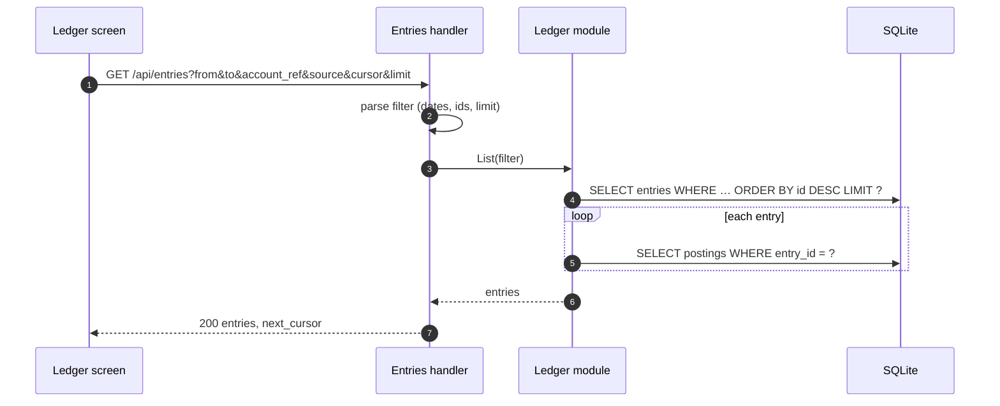

# GET /api/entries

**Auth.** Session cookie (`spenicle_session`). Open mode passes everything through; with a password set, a missing or stale cookie is `401 unauthorized`.

## Purpose

Read the ledger: newest first, filtered, paged, postings included.

## Upstream

Ledger screen, agents auditing spend, `skills/ai-integration`.

## Downstream

`Module.Ledger.List` → `Repository.Sqlite.ListEntries` (one query for
entries, one per entry for its postings).

## Path / query params

| name | type | default | notes |
| --- | --- | --- | --- |
| `from` | date | — | `occurred_on >= from` |
| `to` | date | — | `occurred_on <= to` |
| `account_ref` | int | — | entries touching that account |
| `payee_id` | int | — | entries for that payee |
| `source` | string | — | `manual`, `share`, `email`, `statement`, `recurring`, `adjustment` |
| `cursor` | int | — | return entries with `id < cursor` |
| `limit` | int | 50 | clamped to 200 |

## Body

None.

## Response

`{"entries":[{"ref":1,"occurred_on":"2026-02-14","currency":"IDR","source":"manual","postings":[…]}],"next_cursor":0}`

## Errors

`400 invalid_filter` for a malformed date or cursor.

## Limitations

Offset-free cursor paging only; no running balance (`running_balance`
from the design is not implemented); postings are loaded per entry (N+1), acceptable at
one user's volume.

---

## Sequence

