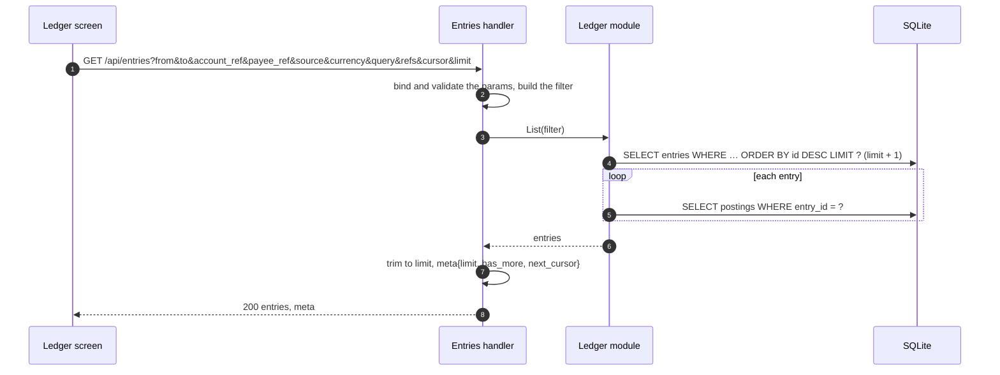

# GET /api/entries

**Auth.** `Authorization: Bearer <credential>`: the instance password, or a token carrying this route's scope. Open mode passes everything through; with a password set, a missing or wrong credential is `401 unauthorized`, and a token without the scope is `403 forbidden`.

## Purpose

Read the ledger: newest first, filtered, paged, postings included.

## Upstream

Ledger screen, agents auditing spend, `skills/ai-integration`.

## Downstream

`Module.Ledger.List` → `Repository.Sqlite.ListEntries` (one query for
entries, one per entry for its postings).

## Path / query params

| name | type | default | notes |
| --- | --- | --- | --- |
| `from` | date | — | `occurred_on >= from` |
| `to` | date | — | `occurred_on <= to` |
| `account_ref` | ref | — | entries touching that account |
| `payee_ref` | ref | — | entries for that payee |
| `source` | string | — | `manual`, `share`, `email`, `statement`, `recurring`, `adjustment` |
| `currency` | string | — | ISO 4217, the entry's own currency |
| `query` | string | — | substring of the entry note |
| `refs` | string | — | comma-separated entry refs |
| `cursor` | ref | — | return entries older than the entry with that ref |
| `limit` | int | 50 | clamped to 200 |

## Body

None.

## Response

`{"entries":[{"ref":"<32 hex>","occurred_on":"2026-02-14","currency":"IDR","source":"manual","note":"coffee","payee":{"ref":"<32 hex>","name":"KOPI KENANGAN"},"postings":[{"account":{"ref":"<32 hex>","name":"Unsorted","kind":"expense"},"account_ref":"<32 hex>","amount_minor":"1500","base_amount_minor":"1500","fx_rate":"1","fx_source":"identity"}]}],"meta":{"limit":50,"has_more":false,"next_cursor":"<32 hex>"}}`

`meta.limit` is the clamped page size the store was asked for, `meta.has_more` is exact
(the store fetches `limit + 1` rows and the handler trims the extra one) and
`meta.next_cursor` is the `ref` of the last returned entry, omitted when the page is
empty. Send it back as `cursor` for the next page: the cursor is always a ref, never an
integer id.

Each posting carries the account's `name` and `kind` next to its `ref`, and an entry with a
payee carries its `name` too, so a screen renders a row without a second call. `voided_at`
appears on a voided entry or its reversal. The handler joins these from
`Repository.Sqlite.ListAccounts` + `ListPayees` once per request — the store stays a
pure data adapter, the HTTP layer owns presentation.

## Errors

`422 invalid_request` for a malformed date, an unknown `currency` or `source`, a `refs`
entry, a `cursor`, `account_ref` or `payee_ref` that is not a 32-hex ref, or a `limit`
over 200.

## Limitations

Keyset paging by entry ref only; no running balance (`running_balance` from the design is
not implemented); postings are loaded per entry (N+1), acceptable at one user's volume.
`query` matches the note only, not the payee name. There is no amount filter: the filter
matches dates, accounts, payees, source, currency and refs, never a number. One entry by
ref is [`GET /api/entries/{ref}`](./GET_api_entries_ref.md); `refs` stays the way to fetch
a batch of unrelated entries in one call.

---

## Sequence

