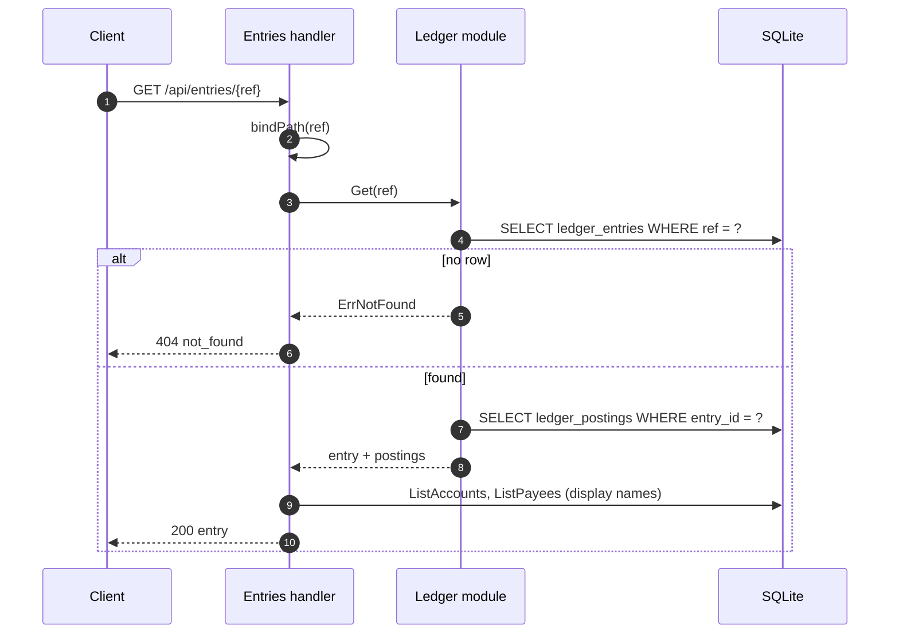

# GET /api/entries/{ref}

**Auth.** `Authorization: Bearer <credential>`: the instance password, or a token carrying this route's scope. Open mode passes everything through; with a password set, a missing or wrong credential is `401 unauthorized`, and a token without the scope is `403 forbidden`.

## Purpose

One entry by ref: the same object `GET /api/entries` returns per row, without the page
envelope. It is the route a deep link opens, the row a capture approval produces, and the
target an `audit_log` line names.

## Upstream

An entry screen reached by URL, the journal (`GET /api/audit`), a capture or recurring
approval that answers with an entry ref, an agent re-reading one posting.

## Downstream

`Module.Ledger.Get` → `Repository.Sqlite.EntryByRef` (one row) →
`Repository.Sqlite.postingsByEntryID` (its postings). The handler then joins display names
from `ListAccounts` + `ListPayees` once, exactly as the list route does, so the store stays
a pure data adapter.

## Path / query params

| name | notes |
| --- | --- |
| `ref` | the entry ref (32 lowercase hex) |

## Body

None.

## Response

**200**

```json
{"ref":"<32 hex>","idempotency_key":"<tokenref>_<16 hex>","occurred_on":"2026-02-14","currency":"IDR","source":"manual","note":"coffee",
 "payee":{"ref":"<32 hex>","name":"KOPI KENANGAN"},
 "postings":[{"account":{"ref":"<32 hex>","name":"Cash","kind":"asset"},
              "account_ref":"<32 hex>","amount_minor":"-18000","base_amount_minor":"-18000",
              "fx_rate":"1","fx_source":"identity"}]}
```

Every posting carries its account's `name` and `kind` next to the ref, and an entry with a
payee carries its `name`, so one call renders the whole screen. `note` is omitted when
empty, `payee` when the entry has none, and `voided_at` (RFC3339) appears once the entry
is voided. There is no `meta`: the page envelope belongs to the list route.

## Errors

- `404 not_found` — the ref names no entry. A ref that never existed and one from another
  database answer identically.
- `422 invalid_request` — the ref is not 32 lowercase hex.
- `500 internal_error` — the read failed; the cause is logged, never sent.

## Limitations

- A void writes a second entry; this route answers the original carrying `voided_at` and
  never follows `reverses_entry_ref`, so the reversal is found through the list route
  (`?source=adjustment`).
- Display names cost two extra reads per request (`ListAccounts`, `ListPayees`), the same
  cost the list route pays. Acceptable at one user's volume.
- No ETag and no `If-None-Match`: an entry only changes when it is voided or its payee is
  reassigned, both of which are user actions in the same screen.
- Read-only. Every mutation stays on `POST /api/entries` and `PATCH /api/entries/{ref}`.

## Sequence


