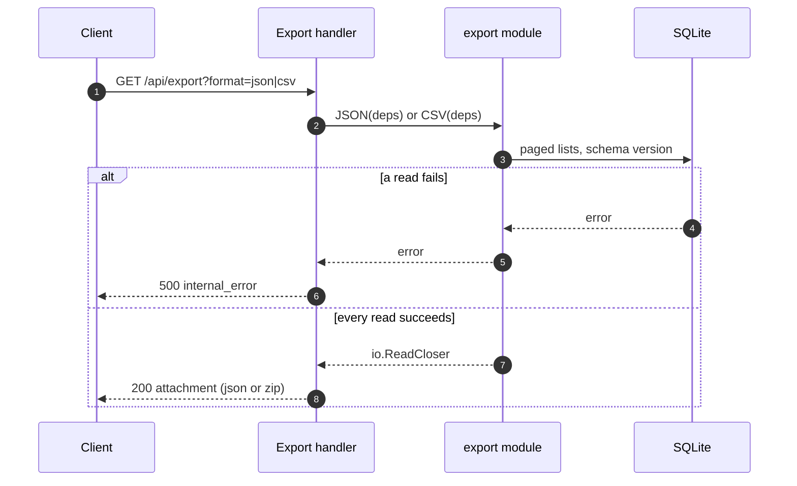

# GET /api/export

**Auth.** Session cookie (`spenicle_session`). Open mode passes everything through; with a password set, a missing or stale cookie is `401 unauthorized`.

## Purpose

Take the whole ledger out in one call: a single JSON document, or a zip of CSV
sheets. Both carry refs only — no integer id, no sealed value, no artifact byte, no
`audit_log`, no password hash and no secret fingerprint — so an export can be handed
to a spreadsheet or kept as a backup without leaking the key.

## Upstream

A backup before an upgrade, a spreadsheet, or the import half of the next slice.

## Downstream

Every read model, paged: `ListAccounts`, `ListPayees`, `ListEntries` (with its
postings), `ListCaptures`, `ListRecurring`, `ListRates` and `ListCustomQueries`, plus
`SchemaVersion`. Nothing writes.

## Path / query params

| name | type | required | notes |
| --- | --- | --- | --- |
| `format` | string | no | `json` (default) or `csv` |

## Body

None.

## Response

`format=json` → `application/json`:

```json
{"schema_version":2,"exported_at":"2026-02-14T09:00:00Z","base_currency":"IDR",
 "accounts":[…],"payees":[…],"entries":[…],"captures":[…],
 "recurring":[…],"rates":[…],"custom_queries":[…]}
```

Money is a string of minor units, timestamps are RFC3339, `occurred_on` and
`on_date` are `YYYY-MM-DD`, every reference is a 32-hex ref. `captures` carries the
status and the extraction rail, never the sealed payload: the text behind a capture
is unrecoverable from an export, by design.

`format=csv` → `application/zip`. The archive is a zip of CSV sheets and
`manifest.json`, in this fixed order:

| file | columns |
| --- | --- |
| `accounts.csv` | ref, name, kind, parent_ref, currency, icon, archived_at, created_at |
| `payees.csv` | ref, name, default_account_ref, default_category_ref, archived_at, created_at |
| `entries.csv` | ref, occurred_on, currency, source, note, client_id, payee_ref, reverses_ref, voided_at, created_at |
| `postings.csv` | entry_ref, account_ref, amount_minor, base_amount_minor, fx_rate, fx_rate_date, fx_source |
| `captures.csv` | ref, kind, status, resolved_entry_ref, extraction_rail, extraction_model, received_at, resolved_at |
| `rates.csv` | ref, base, quote, on_date, rate, source, fetched_at |
| `recurring.csv` | ref, payee_ref, account_ref, category_ref, amount_minor, currency, cadence, interval_n, day_of_month, business_day_shift, next_due_on, ends_on, origin, state, last_posted_on, created_at |
| `custom_queries.csv` | ref, name, namespace, chart, created_at, updated_at |
| `manifest.json` | `{"schema_version":…,"exported_at":"…","files":[{"name":"entries.csv","rows":42,"sha256":"<hex>"}]}` |

Every sheet is a header row plus one row per record; `postings.csv` is the money
sheet, one row per posting. Both formats carry
`Content-Disposition: attachment; filename="spenicle-<YYYY-MM-DD>.<json|zip>"` and
`Cache-Control: no-store`.

## Errors

`422 invalid_request` for a `format` that is neither `json` nor `csv`; `500
internal_error` with the generic message when a read fails — the cause is logged,
never sent.

## Limitations

- The whole document is gathered before the first byte leaves, so a failing read
  answers `500` instead of a truncated `200`. The JSON body is then streamed through
  a pipe; the zip is built in memory because `manifest.json` hashes every sheet.
- Lists come from the same cursor pages the API serves, and each list is written
  sorted: by ref, by `occurred_on` then ref for entries, by `on_date`, `base`,
  `quote` for rates. `exported_at` is the only field that differs between two
  exports of the same data, and a zeroed zip modtime keeps the archive
  byte-identical for identical data.
- A list longer than one page (200 rows) is only guaranteed complete for entries:
  that is the one list whose store order (`id DESC`) matches its cursor (`id <`).
  Accounts (`kind, name, id`), payees (`name, id`), recurring (`next_due_on, id`) and
  captures (status bucket, `received_at, id`) order by something else, so truncating
  such a page can skip a row that the next page never reaches. A personal ledger sits
  far below that ceiling; a bigger one needs an `id`-ordered list on the store first.
- `rates.csv` only holds what this database fetched; an export is not a rate
  archive, and an import is expected to refetch.
- Captures travel without their text, draft or artifact: an export is metadata for
  those, not a restore of the sealed payloads.

## Sequence


