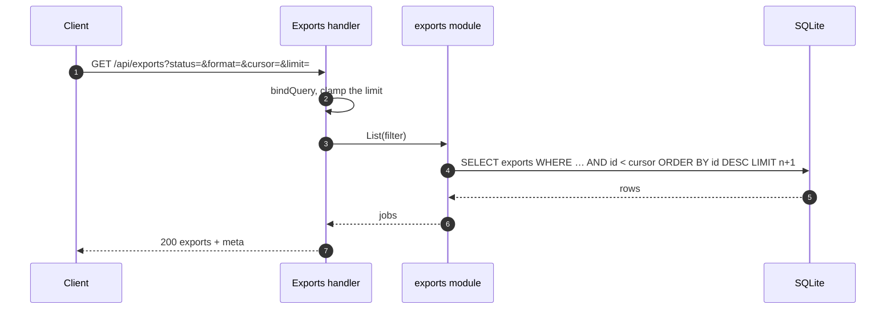

# GET /api/exports

**Auth.** `Authorization: Bearer <credential>`: the instance password, or a token carrying this route's scope. Open mode passes everything through; with a password set, a missing or wrong credential is `401 unauthorized`, and a token without the scope is `403 forbidden`.

## Purpose

The export queue as a list: newest first, filtered by `status` and `format`, in the shared `{items, meta}` envelope under the key `exports`. This is how a screen shows "your export is being prepared" without polling one ref it already lost.

## Upstream

The export panel, and a script watching for a `ready` job while it does something else.

## Downstream

`Module.Exports.List` → `Repository.Sqlite.ListExports` with `status`, `format`, the shared ref cursor and `id DESC`. Counts and timestamps come from the row; the rendered bytes never do.

## Path / query params

| name | type | required | notes |
| --- | --- | --- | --- |
| `status` | string | no | `queued`, `running`, `ready`, `failed` or `expired` |
| `format` | string | no | `json` or `csv` |
| `cursor` | ref | no | the `ref` of the last job on the previous page |
| `limit` | int | no | 1–200, default 50 |

## Body

None.

## Response

`200` with the shared envelope:

```json
{
  "exports": [
    {
      "ref": "3f2a…",
      "client_id": "laptop-2026-02-14",
      "status": "ready",
      "format": "json",
      "schema_version": 1,
      "counts": {"accounts": 3, "entries": 42, "postings": 84},
      "bytes": 1908,
      "created_at": "2026-02-14T09:00:00Z",
      "started_at": "2026-02-14T10:00:00Z",
      "finished_at": "2026-02-14T10:00:01Z",
      "expires_at": "2026-02-15T10:00:01Z"
    }
  ],
  "meta": {"limit": 50, "has_more": false}
}
```

`counts` is omitted until the job is rendered; `error_message` only when it failed. `next_cursor` in `meta` is the ref to send back when `has_more` is true.

## Errors

- `422 invalid_request` — an unknown `status` or `format`, a `cursor` that is not a 32-hex ref, a `limit` out of range.
- `500 internal_error` — the read failed; the cause is logged, never sent.

## Limitations

- No date range and no `client_id` filter: the queue is short and the ref is the identifier the rest of the API speaks.
- A `ready` job keeps appearing here after its blob is swept, as `expired`; the row is the receipt, the download answers `410`.

## Sequence


