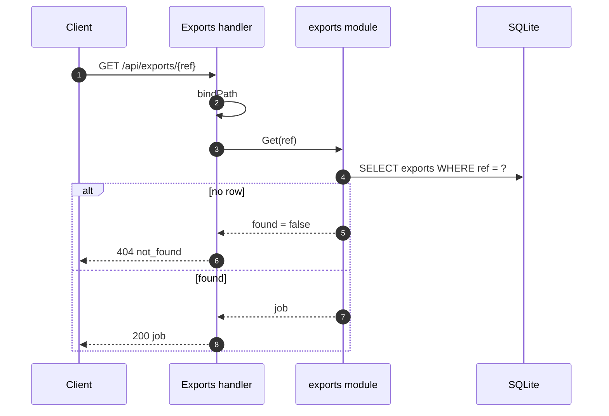

# GET /api/exports/{ref}

**Auth.** `Authorization: Bearer <credential>`: the instance password, or a token carrying this route's scope. Open mode passes everything through; with a password set, a missing or wrong credential is `401 unauthorized`, and a token without the scope is `403 forbidden`.

## Purpose

One export job by ref: its status, its format, the window it covers, the counts of what it rendered and the moment it expires. The job is the promise `POST /api/exports` made, and this is the route a client watches until it reads `ready`.

## Upstream

The export panel after `POST /api/exports`, and a polling script.

## Downstream

`Module.Exports.Get` → `Repository.Sqlite.ExportByRef`. Nothing is rendered and nothing is opened: the blob is metadata here, `GET /api/exports/{ref}/download` streams it.

## Path / query params

| name | notes |
| --- | --- |
| `ref` | the job ref (32 lowercase hex) |

## Body

None.

## Response

`200`:

```json
{
  "ref": "3f2a…",
  "client_id": "laptop-2026-02-14",
  "status": "ready",
  "format": "json",
  "from": "2025-01-01",
  "to": "2025-12-31",
  "schema_version": 1,
  "counts": {"accounts": 3, "entries": 42, "postings": 84},
  "bytes": 1908,
  "created_at": "2026-02-14T09:00:00Z",
  "started_at": "2026-02-14T10:00:00Z",
  "finished_at": "2026-02-14T10:00:01Z",
  "expires_at": "2026-02-15T10:00:01Z"
}
```

The status is one of `queued`, `running`, `ready`, `failed` or `expired`. `counts` is omitted until the job finished, `error_message` only when it failed, and the three timestamps as they happen. `from` and `to` echo the window the job renders and are omitted for an unwindowed job; they are part of the job's identity, so a `client_id` cannot be replayed with another window.

## Errors

- `404 not_found` — the ref names no job.
- `422 invalid_request` — the ref is not 32 lowercase hex.
- `500 internal_error` — the read failed; the cause is logged, never sent.

## Limitations

- The row is the receipt, not the document: a job whose blob the sweep dropped still answers `200` with `status = expired`.
- No ETag and no `If-None-Match`: polling is cheap, and the status is the only thing that changes.

## Sequence


