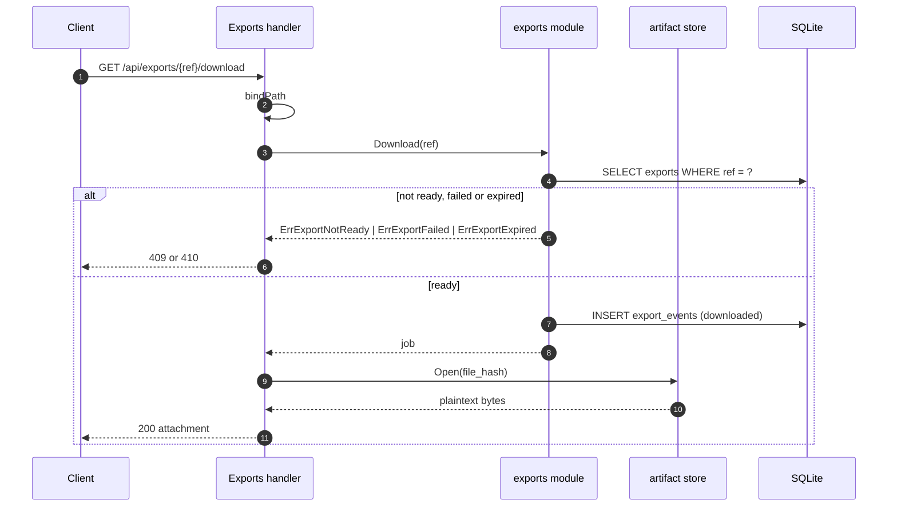

# GET /api/exports/{ref}/download

**Auth.** `Authorization: Bearer <credential>`: the root credential from `POST /api/session`, or a token carrying this route's scope. Open mode passes everything through; with a password set, a missing or stale credential is `401 unauthorized`, and a token without the scope is `403 forbidden`.

## Purpose

The rendered export, streamed from the artifact store as an attachment. The bytes are the job's: the worker rendered them once and stored them, so this route never reads the ledger. Downloading is what records a `downloaded` event.

## Upstream

A finished export in the panel, or a script called after it read `ready`.

## Downstream

`Module.Exports.Download` decides whether the job may be served (and appends the `downloaded` event), then `ArtifactFiles.Open` decrypts the blob the worker stored under `file_hash`. Nothing is rendered here.

| job status | answer |
| --- | --- |
| `ready` | `200` with the bytes |
| `queued`, `running` | `409 export_not_ready` |
| `failed` | `409 export_failed` |
| `expired` | `410 gone` |
| unknown ref | `404 not_found` |

## Path / query params

| name | notes |
| --- | --- |
| `ref` | the job ref (32 lowercase hex) |

## Body

None.

## Response

`200` with `Content-Type: application/json` (`format = json`) or `application/zip` (`format = csv`), and:

```
Content-Disposition: attachment; filename="spenicle-<YYYY-MM-DD>.<json|zip>"
Cache-Control: private, no-store
```

The date is the day the job finished. The JSON document:

```json
{
  "schema_version": 1,
  "exported_at": "2026-02-14T09:00:00Z",
  "base_currency": "IDR",
  "summary": {
    "accounts": [
      {"ref": "…", "name": "Cash", "kind": "asset", "currency": "IDR", "balance_minor": "-25000"}
    ],
    "months": [{"month": "2026-02", "spend_minor": "25000", "income_minor": "0"}],
    "categories": [{"account_ref": "…", "name": "Unsorted", "spend_minor": "25000"}],
    "counts": {"accounts": 2, "payees": 0, "entries": 1, "postings": 2, "captures": 0,
               "recurring": 0, "rates": 3, "custom_queries": 0}
  },
  "data": {
    "accounts": […], "payees": […], "entries": […], "captures": […],
    "recurring": […], "rates": […], "custom_queries": […]
  }
}
```

`data` is the canonical, re-importable half: money is a string of minor units, timestamps are RFC3339, dates are `YYYY-MM-DD`, every reference is a 32-hex ref, and no integer id or sealed value appears. `summary` is display sugar computed from the same rows: one balance per account (base currency), spend and income per month, spend per expense category, and the row count per table — it is not re-importable and never replaces `data`.

The `csv` job is a zip, in this fixed order: `accounts.csv`, `payees.csv`, `entries.csv`, `postings.csv`, `captures.csv`, `rates.csv`, `recurring.csv`, `custom_queries.csv`, `summary.json` (the same `summary` object), `manifest.json` (`{"schema_version":…,"exported_at":"…","files":[{"name":"entries.csv","rows":42,"sha256":"<hex>"}]}`). Each sheet is a header row plus one row per record; `postings.csv` is the money sheet, one row per posting.

## Errors

- `404 not_found` — the ref names no job.
- `409 export_not_ready` — the job is `queued` or `running`; wait for the worker.
- `409 export_failed` — rendering failed; `GET /api/exports/{ref}` carries the generic `error_message`.
- `410 gone` — the job is `expired`: its blob was swept after `ExportRetention` (24h by default).
- `422 invalid_request` — the ref is not 32 lowercase hex.
- `500 internal_error` — the blob is missing or does not authenticate; the row and the document disagree, and the cause is logged, never sent.

## Limitations

- The download is recorded before the first byte leaves: a client that disconnects mid-stream still leaves a `downloaded` event.
- One blob per job, never re-rendered. A ledger change after the job finished is not in the document; queue another export.
- The bytes are encrypted under `APP_SECRET` exactly like capture artifacts: a changed secret makes every stored export unreadable, and the next boot does not notice.

## Sequence


