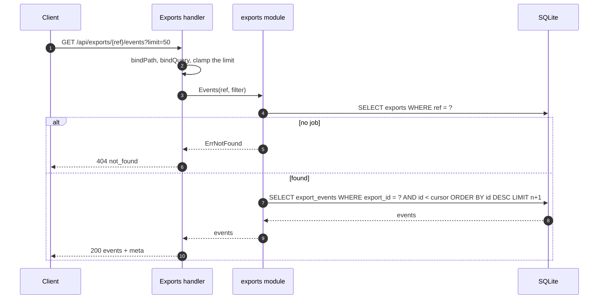

# GET /api/exports/{ref}/events

**Auth.** `Authorization: Bearer <credential>`: the instance password, or a token carrying this route's scope. Open mode passes everything through; with a password set, a missing or wrong credential is `401 unauthorized`, and a token without the scope is `403 forbidden`.

## Purpose

The append-only trail of one export job, newest first: queued, resumed, started, completed, failed, downloaded, expired or swept. It answers "why is my export not there" without opening the database.

## Upstream

The export panel's history drawer, and a script proving that a job was rendered and when.

## Downstream

`Module.Exports.Events`: load the job by ref (`404` when it names none), then `Repository.Sqlite.ListExportEvents` with `export_id`, the shared ref cursor and `id DESC`.

| kind | actor | when |
| --- | --- | --- |
| `queued` | `user` | `POST /api/exports` stored a new job |
| `resumed` | `user` / `worker` | the same `idempotency_key` and `format` came back (`user`), or the worker requeued a job a restart left `running` (`worker`) |
| `started` | `worker` | the worker won the compare-and-swap on the row |
| `completed` | `worker` | the document was rendered, stored and the job marked `ready` |
| `failed` | `worker` | rendering failed; `error_message` on the job says so generically |
| `downloaded` | `user` | `GET /api/exports/{ref}/download` streamed a `ready` job |
| `expired` | `worker` | the sweep dropped a blob past `ExportRetention` |
| `swept` | `worker` | the sweep failed a `running` job older than `ExportStaleAfter` |

A refused create (`409 export_conflict`) writes nothing: the existing job is left alone. A requeue after a restart is the other `resumed`, and it carries `actor = worker` because the worker writes it before claiming the job.

## Path / query params

| name | notes |
| --- | --- |
| `ref` | the job ref (32 lowercase hex) |
| `cursor` | the `ref` of the last event on the previous page |
| `limit` | 1–200, default 50 |

## Body

None.

## Response

`200` with the shared envelope:

```json
{
  "events": [
    {
      "ref": "9c11…",
      "kind": "completed",
      "actor": "worker",
      "at": "2026-02-14T10:00:01Z"
    }
  ],
  "from": "2025-01-01",
  "to": "2025-12-31",
  "meta": {"limit": 50, "has_more": false}
}
```

`payload` appears only when a kind carries one; no export kind carries one today. `from` and `to` echo the window of the job the trail belongs to and are omitted for an unwindowed job. `next_cursor` in `meta` is the ref to send back when `has_more` is true.

## Errors

- `404 not_found` — the ref names no job.
- `422 invalid_request` — `cursor` is not a 32-hex ref, `limit` is out of range.
- `500 internal_error` — the read failed; the cause is logged, never sent.

## Limitations

- No `kind` filter and no date range: one job's trail is a handful of events.
- The trail outlives the blob: an `expired` event is the last proof the document existed, and it stays after the bytes are gone.

## Sequence


