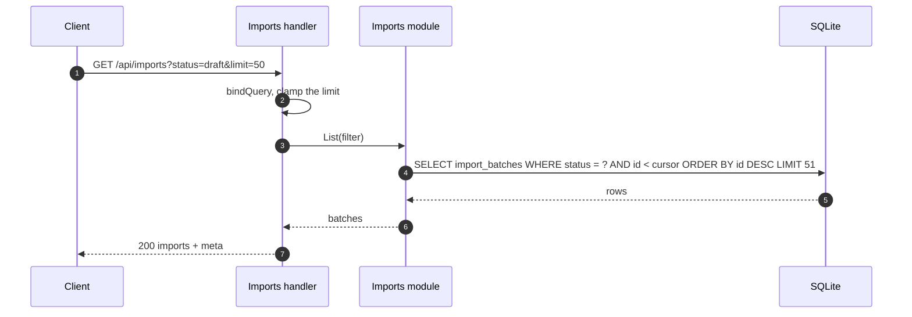

# GET /api/imports

**Auth.** `Authorization: Bearer <credential>`: the instance password, or a token carrying this route's scope. Open mode passes everything through; with a password set, a missing or wrong credential is `401 unauthorized`, and a token without the scope is `403 forbidden`.

## Purpose

Every statement batch, newest first, so the shell can show what is drafted, what was committed and what was rejected. Terminal batches stay in the list forever: a `committed` or `rejected` one keeps its rows, its blob and its events, and never expires.

## Upstream

The shell's import list; a script checking whether a draft survived a restart.

## Downstream

`Module.Imports.List`: `Repository.Sqlite.ListImportBatches`, ordered by `id DESC`, one `status` filter and the shared ref cursor. The filter matches any of the three states, so `status=committed` and `status=rejected` return the closed batches the worker leaves alone. Rows are **not** loaded here — the list carries `rows_total`, and `GET /api/imports/{ref}` loads the rows.

## Path / query params

| name | notes |
| --- | --- |
| `status` | `draft`, `committed` or `rejected`; omit for every batch |
| `cursor` | the `ref` of the last batch on the previous page |
| `limit` | 1–200, default 50 |

## Body

None.

## Response

`200` with the shared envelope: `{"imports": [...], "meta": {"limit": 50, "has_more": false}}`. Each row of `imports` is the batch document from [`POST /api/imports`](./POST_api_imports.md) without `rows`.

`next_cursor` in `meta` is the ref to send back when `has_more` is true.

## Errors

- `422 invalid_request` — `status` is not one of the three, `cursor` is not a 32-hex ref, `limit` is out of range.

## Limitations

No date or `idempotency_key` filter; the ledger-sized list is small enough that `status` plus the cursor covers the shell. Rows are never inlined, so a hundred-row draft costs one extra request — `GET /api/imports/{ref}` loads them and `GET /api/imports/{ref}/events` loads the log.

## Sequence

