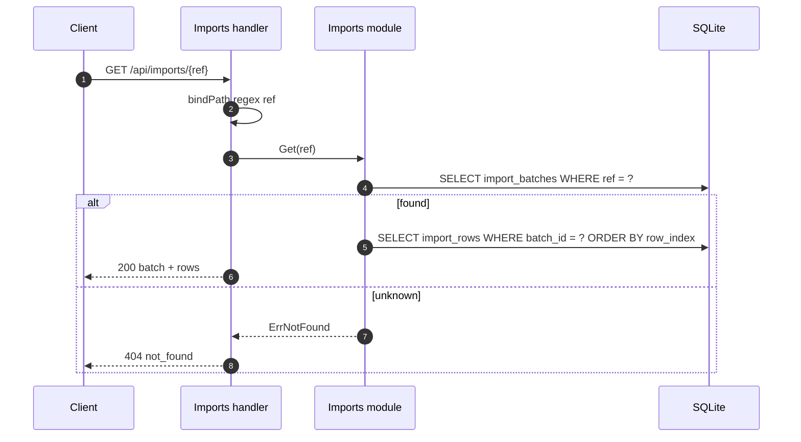

# GET /api/imports/{ref}

**Auth.** Session cookie (`spenicle_session`). Open mode passes everything through; with a password set, a missing or stale cookie is `401 unauthorized`.

## Purpose

One statement batch **with its rows**: the review screen after a restart, or the confirmation that a draft survived.

## Upstream

The shell opening a draft; a script resuming an upload it already sent.

## Downstream

`Module.Imports.Get`: `Repository.Sqlite.ImportBatchByRef`, then `ImportRows` ordered by `row_index`. The document is byte-shaped like the upload response, so a client uses one decoder for all six routes.

## Path / query params

`{ref}` is the batch ref (32 lowercase hex).

## Body

None.

## Response

`200` with the batch document described in [`POST /api/imports`](./POST_api_imports.md): `status` is `draft`, `committed` or `rejected`, `rows` carries every row with its `status` (`pending`, `accepted`, `skipped`), `clash_kind` and `clash_entry_ref` when there was a clash.

## Errors

- `404 not_found` — no batch holds that ref (a batch the worker reclaimed looks the same).
- `422 invalid_request` — `{ref}` is not 32 hex characters.

## Limitations

No ETag and no conditional GET; a client polls with a plain request or opens the list first. A reclaimed (expired) draft is gone, not tombstoned — the ledger entries it may have committed stay.

## Sequence

