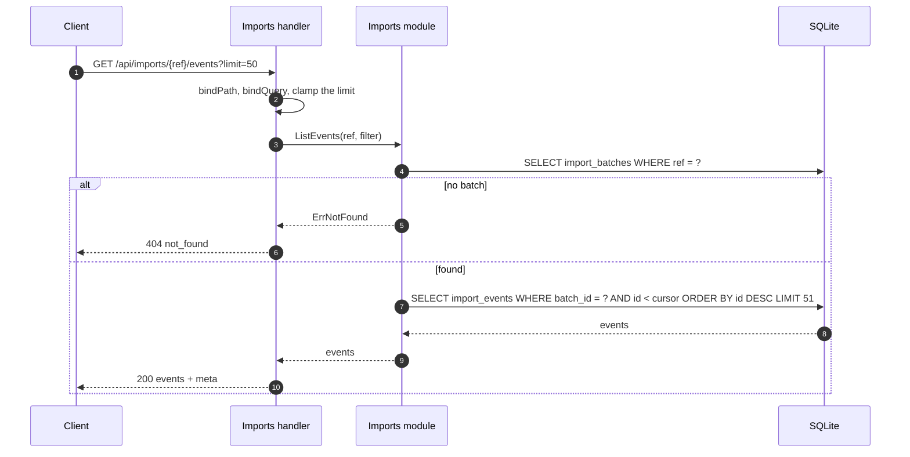

# GET /api/imports/{ref}/events

**Auth.** Session cookie (`spenicle_session`). Open mode passes everything through; with a password set, a missing or stale cookie is `401 unauthorized`.

## Purpose

The audit trail of one statement batch, newest first: what was uploaded, resumed or refused, which row was edited and with which fields, which rows were accepted or skipped, and how the review ended. The log is append-only — nothing rewrites or deletes an event, and a rejected batch keeps its events forever.

## Upstream

The review screen's "history" drawer; a script proving why a row is not in the ledger.

## Downstream

`Module.Imports.ListEvents`: load the batch by ref (`404` when it names none), then `Repository.Sqlite.ListImportEvents` with `batch_id`, the shared ref cursor and `id DESC`.

The kinds written by the API paths (`actor = user`):

| kind | when | `row_index` | `payload` |
| --- | --- | --- | --- |
| `uploaded` | a new draft was stored | — | — |
| `resumed` | the same `client_id` + bytes came back to an existing batch | — | — |
| `conflict_refused` | the same `client_id` arrived with different bytes (`409 import_conflict`) | — | — |
| `row_edited` | a row patch applied | the row | `{"fields": ["occurred_on", "amount_minor"]}`, in request order |
| `row_accepted` | a row patch moved the row to `accepted` | the row | — |
| `row_skipped` | a row patch moved the row to `skipped` | the row | — |
| `committed` | `PATCH /api/imports/{ref}` with `action = commit` | — | — |
| `rejected` | `PATCH /api/imports/{ref}` with `action = reject` | — | `{"reason": "..."}` when one was sent |

The worker writes one more kind, with `actor = worker`:

| kind | when | `row_index` | `payload` |
| --- | --- | --- | --- |
| `expired` | an abandoned `draft` passed `expires_at` and the GC dropped its rows and blob | — | — |

A replayed action writes no event: the second `commit` or `reject` returns the batch without touching the log.

## Path / query params

| name | notes |
| --- | --- |
| `ref` | the batch ref (32 lowercase hex) |
| `cursor` | the `ref` of the last event on the previous page |
| `limit` | 1–200, default 50 |

## Body

None.

## Response

`200` with the shared envelope:

```json
{
  "events": [
    {
      "ref": "3f2a…",
      "kind": "row_edited",
      "row_index": 0,
      "payload": {"fields": ["amount_minor"]},
      "actor": "user",
      "at": "2026-02-14T09:12:33Z"
    }
  ],
  "meta": {"limit": 50, "has_more": false}
}
```

`row_index` and `payload` are omitted when the kind carries neither. `next_cursor` in `meta` is the ref to send back when `has_more` is true.

## Errors

- `404 not_found` — the ref names no batch.
- `422 invalid_request` — `cursor` is not a 32-hex ref, `limit` is out of range.

## Limitations

One batch per request, no `kind` filter and no date range: the log of a single statement is tens of events, and the rows of the log are not exported yet. An `expired` event outlives the batch row the worker deletes, so it is reachable through SQL and the export, not through this route.

## Sequence


