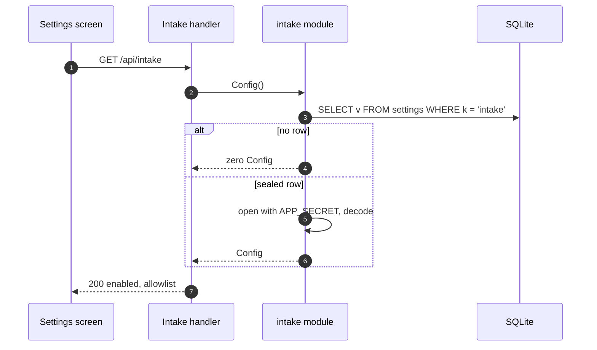

# GET /api/intake

**Auth.** `Authorization: Bearer <credential>`: the instance password, or a token carrying this route's scope. Open mode passes everything through; with a password set, a missing or wrong credential is `401 unauthorized`, and a token without the scope is `403 forbidden`. This route lives in the root-only group, so only the instance password reaches it.

## Purpose

The intake configuration: whether polling is on and which senders may become captures. The
credentials that back it are sealed elsewhere and are never echoed here.

## Upstream

The settings screen, and `GET /api/connections` next to it — one answers "what may be
polled", the other "is the mailbox authorised".

## Downstream

`Module.Intake.Config` → `Repository.Sqlite.Setting` for the `intake` key, opened with
`APP_SECRET`.

## Path / query params

None.

## Body

None.

## Response

**200** `{"enabled":false,"allowlist":[]}`

An instance that never configured intake answers the zero value: off, no allowlist. An
empty allowlist means *every* sender is accepted once polling is switched on.

## Errors

- `500 internal_error` — the sealed row could not be opened; the cause is logged, never sent.

## Limitations

- Two fields only. The poll interval, the 72h window and the 50-message burst are constants,
  not settings.
- No `last_polled_at`: the outcome of a run is the worker's log line, not a stored fact.

## Sequence

