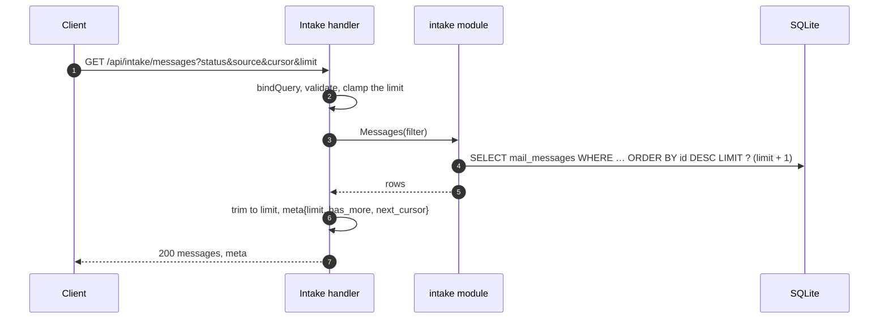

# GET /api/intake/messages

**Auth.** Instance password only. This route lives in the root-only group: a scoped Bearer credential is refused with `403 forbidden` before the handler runs; with no password seeded, open mode passes the request through.

## Purpose

The mail references, newest first: what was polled, what each mail became, and what to refresh.
No mail content — the body stays sealed in the capture.

## Upstream

The settings screen's intake panel, and an agent auditing why a mail did not become a capture.

## Downstream

`Module.Intake.Messages` → `Repository.Sqlite.ListMailMessages` (one query, keyset paged).

## Path / query params

| name | type | default | notes |
| --- | --- | --- | --- |
| `status` | string | — | `captured`, `skipped`, `failed`, `gone` |
| `source` | string | — | `gmail`; `imap` validates but no IMAP adapter is shipped |
| `cursor` | ref | — | return references older than the one with that ref |
| `limit` | int | 50 | clamped to 200 |

## Body

None.

## Response

**200**

```json
{"messages":[{"ref":"<32 hex>","source":"gmail","handle":"18c…","status":"captured",
  "received_at":"2026-02-14T09:00:00Z","observed_at":"2026-02-14T09:05:00Z",
  "last_synced_at":"2026-02-14T09:05:00Z"}],
 "meta":{"limit":50,"has_more":false}}
```

The same object `GET /api/intake/messages/{ref}` returns, inside the shared list envelope.

## Errors

- `422 invalid_request` — a `status` or `source` outside the enum, a `cursor` that is not a ref, or a `limit` over 200.
- `500 internal_error` — the read failed.

## Limitations

- Keyset paging by reference only; no date range and no sender filter — the sender is not stored (it lives in the sealed capture).
- A listing never triggers a poll: use `POST /api/intake/run` for that.

## Sequence


