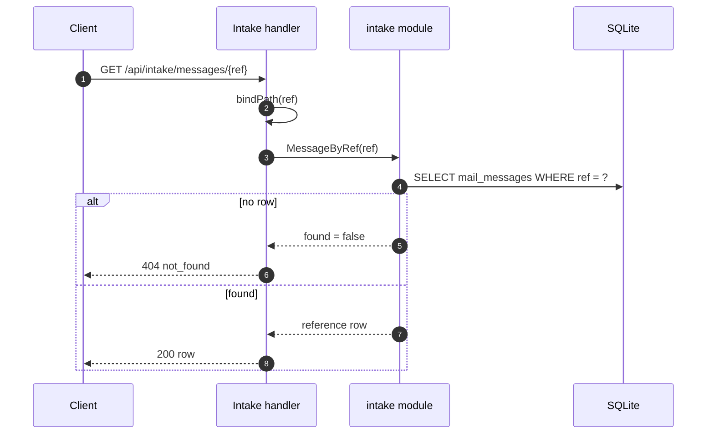

# GET /api/intake/messages/{ref}

**Auth.** Instance password only. This route lives in the root-only group: a scoped Bearer credential is refused with `403 forbidden` before the handler runs; with no password seeded, open mode passes the request through.

## Purpose

One mail reference: which provider message produced which capture, what happened to it, and
the handle a refresh would use. It carries no mail content — the body is sealed in the capture.

## Upstream

The settings screen's intake list, and a log line that named a reference.

## Downstream

`Module.Intake.MessageByRef` → `Repository.Sqlite.MailMessageByRef`.

## Path / query params

| name | notes |
| --- | --- |
| `ref` | the mail reference (32 lowercase hex) |

## Body

None.

## Response

**200**

```json
{"ref":"<32 hex>","source":"gmail","handle":"18c…","message_id_header":"<abc@bank.example>",
 "provider_revision":"1042","received_at":"2026-02-14T09:00:00Z","observed_at":"2026-02-14T09:05:00Z",
 "status":"captured","last_synced_at":"2026-02-14T09:05:00Z"}
```

`status` is `captured`, `skipped`, `failed` or `gone`; `skip_reason` names why a skip happened
(`sender_not_allowed`, `no_body`, `duplicate`, `too_large`), and `superseded_by` points at the
reference that replaced this one after a refresh.

## Errors

- `404 not_found` — no reference with that ref.
- `422 invalid_request` — the ref is not 32 lowercase hex.
- `500 internal_error` — the read failed.

## Limitations

- Use `GET /api/intake/messages` for the list; this route addresses one known ref.
- `capture_ref` is not exposed by this handler: the capture is reached through
  `GET /api/captures` by its own ref.

## Sequence


