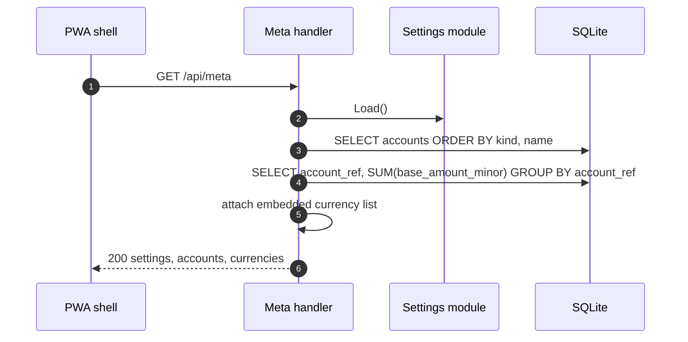

# GET /api/meta

**Auth.** Session cookie (`spenicle_session`). Open mode passes everything through; with a password set, a missing or stale cookie is `401 unauthorized`.

## Purpose

One round trip fills the shell: settings, every account with a derived
balance, and the embedded currency list.

## Upstream

PWA bootstrap, agents discovering account ids.

## Downstream

`Module.Settings.Load`; `Repository.Sqlite.ListAccounts`;
`Repository.Sqlite.BalancesByAccount` (`SUM(base_amount_minor)` grouped by account);
`entity.Currencies()` (compiled-in list, no table).

## Path / query params

None.

## Body

None.

## Response

```json
{"settings":{"base_currency":"IDR","timezone":"UTC","extraction_enabled":false},
 "accounts":[{"ref":1,"name":"Cash","kind":"asset","currency":"IDR",
              "base_amount_minor":"0","archived":false}],
 "currencies":[{"code":"AUD","minor_units":2,"symbol":"A$"}]}
```

## Errors

None.

## Limitations

No payees or recurring rules yet (both tables exist, no endpoints);
balances are all-time, not per month. `settings.timezone` is read-only: it is
set once at the first boot from `APP_TIMEZONE` (default `UTC`).


---

## Sequence


