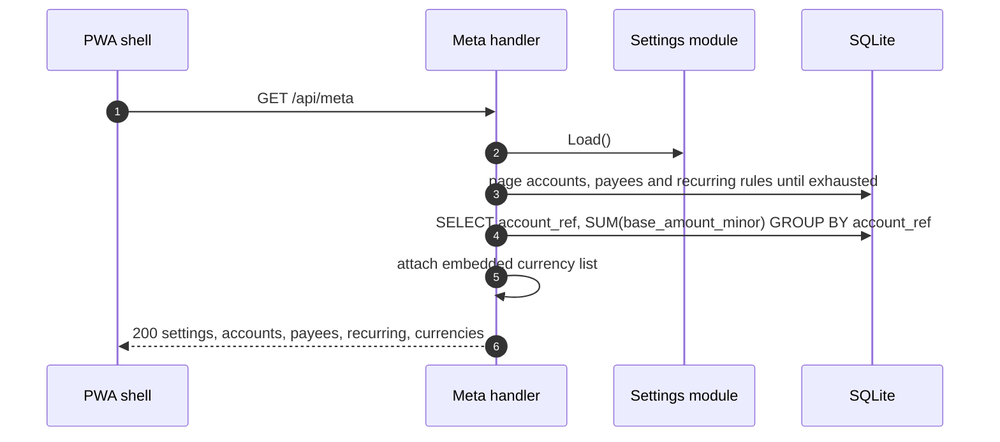

# GET /api/meta

**Auth.** `Authorization: Bearer <credential>`: the instance password, or a token carrying all four scopes for the embedded collections: `settings:read`, `accounts:read`, `payees:read` and `recurring:read`. Open mode passes everything through; with a password set, a missing or wrong credential is `401 unauthorized`, and a token missing any required scope is `403 forbidden` before any collection is read.
A fresh instance answers this route without a credential, because none exists yet; once setup has set one, the root credential (or a token with the four read scopes) is required.

## Purpose

One authenticated round trip fills the shell: settings, every account with its derived
all-time balance, every payee, every recurring rule and the embedded currency list.
Collections are complete, not first pages, and empty collections are `[]`.

## Upstream

PWA bootstrap and agents discovering account, payee and recurring-rule refs.

## Downstream

`Module.Settings.Load`; `Repository.Sqlite.ListAccounts`;
`Repository.Sqlite.BalancesByAccount` (`SUM(base_amount_minor)` grouped by account);
`Repository.Sqlite.ListPayees`; `Repository.Sqlite.ListRecurring`;
`entity.Currencies()` (compiled-in list, no table).

## Path / query params

None.

## Body

None.

## Response

```json
{
  "settings": {
    "base_currency": "IDR",
    "timezone": "UTC",
    "extraction_enabled": false,
    "ai_assistance": false
  },
  "accounts": [{
    "ref": "00000000000000000000000000000003",
    "name": "Cash",
    "kind": "asset",
    "currency": "IDR",
    "base_amount_minor": "0",
    "archived": false
  }],
  "payees": [{
    "ref": "00000000000000000000000000000004",
    "name": "Kopi Kenangan",
    "default_account_ref": "00000000000000000000000000000003",
    "default_category_ref": "00000000000000000000000000000002",
    "archived": false,
    "created_at": "2026-02-14T08:00:00Z"
  }],
  "recurring": [{
    "ref": "00000000000000000000000000000005",
    "payee_ref": "00000000000000000000000000000004",
    "account_ref": "00000000000000000000000000000003",
    "amount_minor": "25000",
    "currency": "IDR",
    "cadence": "monthly",
    "interval_n": 1,
    "business_day_shift": "none",
    "next_due_on": "2026-03-20",
    "origin": "user",
    "state": "active",
    "created_at": "2026-02-14T08:00:00Z"
  }],
  "currencies": [{"code":"IDR","minor_units":0,"symbol":"Rp"}]
}
```

The settings block is the same shape as `GET /api/settings`, including
`timezone`. `settings.extraction_enabled` is true when the SnapToJSON rail
is configured (`SNAPTOJSON_API_KEY` set). `settings.ai_assistance` is true only when
`OPENAI_HOST`, `OPENAI_API_KEY` and `OPENAI_MODEL` are all set. The two flags are
independent: OpenAI is reserved for a future chat endpoint and does not run extraction
today, so only `extraction_enabled` gates a working feature.

The handler follows every repository cursor internally, in the same sort order as each
list endpoint, so the normal 200-row list cap does not truncate this bootstrap payload.

## Errors

`403 forbidden` — a token is missing one of the four embedded-collection read scopes; no collection is read.
`500 internal_error` — settings, an account page, balances, payees or recurring rules cannot be read.

## Limitations

Balances are all-time, not per month. Capture/import/export queue counts are not part
of meta; read those from their list routes. `settings.timezone` is read-only: it is set
once at the first boot from `APP_TIMEZONE` (default `UTC`).

---

## Sequence


