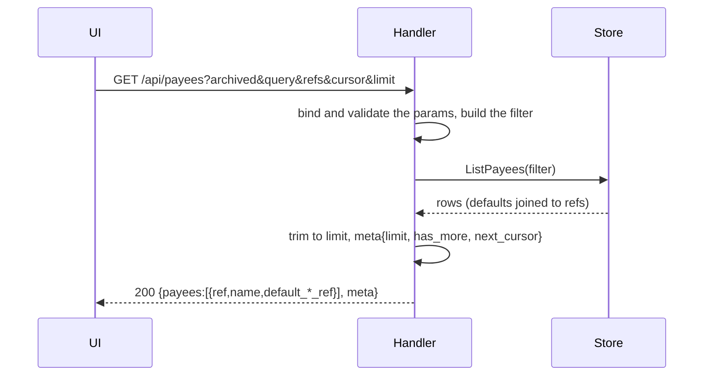

# GET /api/payees

**Auth.** `Authorization: Bearer <credential>`: the root credential from `POST /api/session`, or a token carrying this route's scope. Open mode passes everything through; with a password set, a missing or stale credential is `401 unauthorized`, and a token without the scope is `403 forbidden`.

## Purpose

List every payee with its default account and category, so the entry form can suggest a payee and pre-fill the accounts that belong to it.

## Upstream

Payee picker, autofill on the entry form, merchant filters.

## Downstream

`Repository.Sqlite.ListPayees` (one query, `LEFT JOIN accounts` twice to return both defaults as refs, ordered by name).

## Path / query params

| name | type | default | notes |
| --- | --- | --- | --- |
| `archived` | bool | all | `true` only archived, `false` only live |
| `query` | string | — | substring of the payee name, case-insensitive |
| `refs` | string | — | comma-separated payee refs |
| `cursor` | ref | — | payees after the one with that ref, in name order |
| `limit` | int | 50 | clamped to 200 |

Archived payees are included by default and flagged, so the client can hide them.

## Body

None.

## Response

`{"payees":[{"ref":"<32 hex>","name":"KOPI KENANGAN","default_account_ref":"<32 hex>","default_category_ref":"<32 hex>","archived":false,"created_at":"<iso 8601>"}],"meta":{"limit":50,"has_more":false,"next_cursor":"<32 hex>"}}`

`default_account_ref` and `default_category_ref` are omitted when unset. `meta` is the block every list route answers: `limit` is the clamped page size, `has_more` is exact (the store fetches `limit + 1`, the handler trims) and `next_cursor` is the `ref` of the last returned payee, omitted on an empty page.

## Errors

`500 internal_error` with the generic message `internal error`; the cause is logged, never returned.

## Limitations

`query` is a `LIKE` on the name only; there is no fuzzy match and no ranking. Payees are not created implicitly by an entry — `POST /api/payees` owns that.

## Sequence

