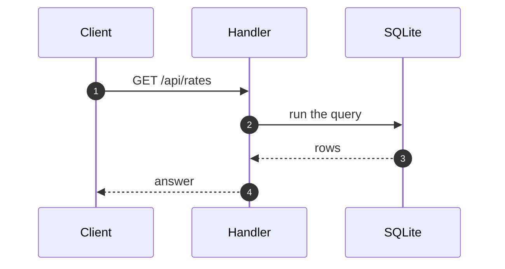

# GET /api/rates

**Auth.** `Authorization: Bearer <credential>`: the root credential from `POST /api/session`, or a token carrying this route's scope. Open mode passes everything through; with a password set, a missing or stale credential is `401 unauthorized`, and a token without the scope is `403 forbidden`.

## Purpose

The reference rate for one pair on one day, from the in-memory cache the
system filled at boot.

## Upstream

`rates.Contract.Rate` → the in-memory cache, falling back to `fx_rates` on a miss. Nothing downstream.

## Downstream

None.

## Path / query params

| name | type | required | notes |
| --- | --- | --- | --- |
| `base` | string | yes | ISO 4217; the stored base is always `EUR` |
| `quote` | string | yes | ISO 4217 |
| `on` | string | no | `YYYY-MM-DD`; empty means today, which usually misses |

## Body

None.

## Response

`{"base":"EUR","quote":"USD","on_date":"2026-11-20","rate":"1.0990","source":"ecb","fetched_at":"…"}`

## Errors

`404 not_found` when that day was never fetched; `422 invalid_request` for a
malformed date or an unknown currency code.

## Limitations

Exact day only — no nearest-earlier-business-day fallback, and no cross
rates: an `IDR` → `USD` conversion is not derived from two EUR legs yet. There is no
public write: the scrape happens at boot, so a long-running process serves the sheet it
started with.

---

## Sequence

