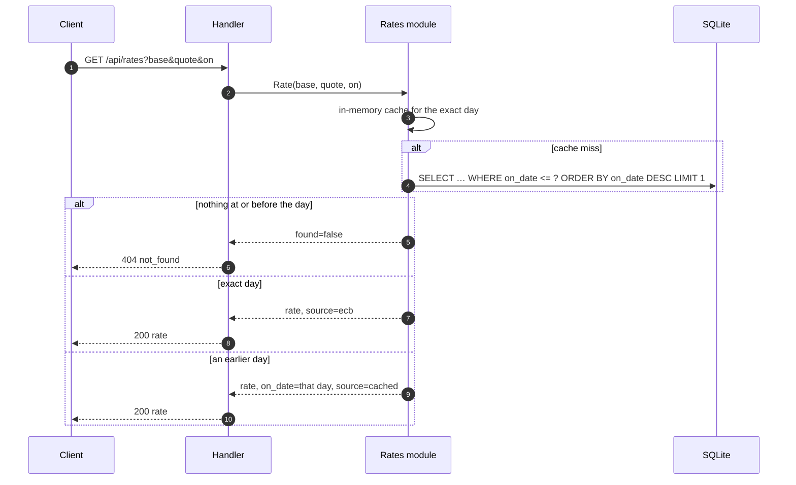

# GET /api/rates

**Auth.** `Authorization: Bearer <credential>`: the instance password, or a token carrying this route's scope. Open mode passes everything through; with a password set, a missing or wrong credential is `401 unauthorized`, and a token without the scope is `403 forbidden`.

## Purpose

The reference rate for one pair on the day asked for, or on the nearest earlier business
day the sheet has — never a future one.

## Upstream

Ledger screens, agents pricing a foreign amount before posting it.

## Downstream

`Module.Rates.Rate` → the in-memory cache first, then `Repository.Sqlite.RateOnOrBefore`.
Nothing downstream.

## Path / query params

| name | type | required | notes |
| --- | --- | --- | --- |
| `base` | string | yes | ISO 4217; the stored base is always `EUR` |
| `quote` | string | yes | ISO 4217 |
| `on` | string | no | `YYYY-MM-DD`; empty means today |

## Body

None.

## Response

`{"ref":"<32 hex>","base":"EUR","quote":"USD","on_date":"2026-11-20","rate":"1.0990","source":"ecb","fetched_at":"…"}`

`on_date` is the day the answer actually comes from. `source` is `ecb` when that is the day
requested and `cached` when the sheet had no row for it and the nearest earlier business day
was carried instead — a Saturday, a holiday, or a day after the last scrape. A pair the
sheet has never carried answers `404`.

## Errors

`404 not_found` when the sheet has no row for that day or any earlier day of that pair,
with `not found: no EUR/USD rate on or before <day>`; `422 invalid_request` for a malformed
date or an unknown currency code.

## Limitations

No cross rates here: this route answers the pair as stored, so `IDR` → `USD` is `404` unless
it was scraped. `Module.Ledger.Post` derives that conversion itself when it resolves a
posting (two EUR legs, `eurToBase / eurToNative`), but the route does not. There is no
public write: the scrape happens at boot, so a long-running process serves the sheet it
started with, and a future day always misses by definition.

---

## Sequence

