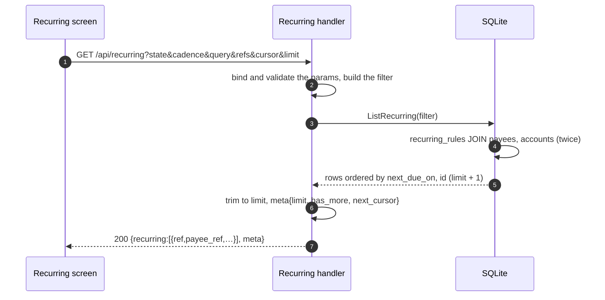

# GET /api/recurring

**Auth.** `Authorization: Bearer <credential>`: the instance password, or a token carrying this route's scope. Open mode passes everything through; with a password set, a missing or wrong credential is `401 unauthorized`, and a token without the scope is `403 forbidden`.

## Purpose

List the recurring rules: what repeats, how often and when it is next due, soonest first, so a screen can show the schedule and an agent can see which rules are still running.

## Upstream

Recurring screen, and an agent checking what is already planned before proposing a rule.

## Downstream

`Repository.Sqlite.ListRecurring` (one query: `recurring_rules` joined to `payees` for the payee ref and to `accounts` twice for the account and category refs, ordered by `next_due_on, id`).

## Path / query params

| name | type | default | notes |
| --- | --- | --- | --- |
| `state` | string | all | `suggested`, `active`, `paused`, `ended` |
| `cadence` | string | all | `daily`, `weekly`, `monthly`, `yearly` |
| `query` | string | — | case-insensitive prefix of the payee name |
| `refs` | string | — | comma-separated rule refs |
| `cursor` | ref | — | rules after the one with that ref, in `next_due_on` order |
| `limit` | int | 50 | clamped to 200 |

Every other list parameter (`kind`, `status`, `source`, `from`, …) is accepted by the shared binder and ignored here.

## Body

None.

## Response

`{"recurring":[{"ref":"<32 hex>","payee_ref":"<32 hex>","account_ref":"<32 hex>","category_ref":"<32 hex>","amount_minor":"25000","currency":"IDR","cadence":"monthly","interval_n":1,"day_of_month":20,"business_day_shift":"none","next_due_on":"2026-12-20","origin":"user","state":"active","created_at":"<iso 8601>"}],"meta":{"limit":50,"has_more":false,"next_cursor":"<32 hex>"}}`

`amount_minor` is a string of minor units; `category_ref` and `ends_on` are omitted when unset. `meta` is the block every list route answers: `limit` is the clamped page size, `has_more` is exact (the store fetches `limit + 1` rows and the handler trims the extra one) and `next_cursor` is the `ref` of the last returned rule, omitted when the page is empty. Send it back as `cursor` for the next page: the cursor is always a ref, never an integer id.

## Errors

`422 invalid_request` for an unknown `state` or `cadence`, a `refs` entry or `cursor` that is not a 32-hex ref, or a `limit` over 200.

## Limitations

Rules are read-only here: steering one (pausing, ending, moving the due date) is
`PATCH /api/recurring/{ref}`. The worker turns a due rule into a queued `captures` row;
it never posts an entry. Detection and suggested-rule promotion are **planned, not shipped**.
`query` matches the payee name only, as a case-insensitive prefix.

## Sequence

