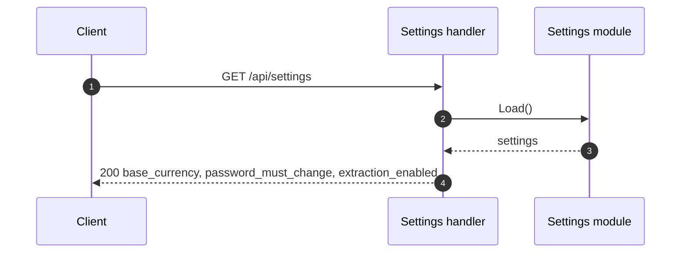

# GET /api/settings

**Auth.** Session cookie (`spenicle_session`). Open mode passes everything through; with a password set, a missing or stale cookie is `401 unauthorized`.

## Purpose

What the shell reads instead of environment variables.

## Upstream

Settings screen; anything that needs to know whether extraction is on.

## Downstream

`Module.Settings.Load` → `settings` row.

## Path / query params

None.

## Body

None.

## Response

`{"base_currency":"IDR","password_must_change":false,"extraction_enabled":false}`

## Errors

None.

## Limitations

`extraction_enabled` reflects whether `SNAPTOJSON_API_KEY` is set at
boot; it is not editable through the API yet.

---

## Sequence

