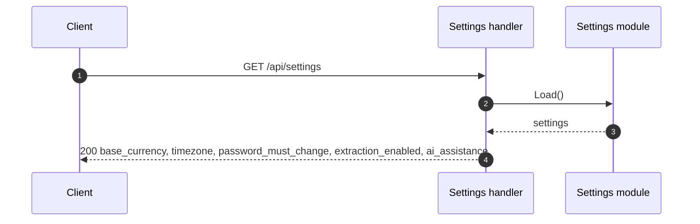

# GET /api/settings

**Auth.** `Authorization: Bearer <credential>`: the instance password, or a token carrying this route's scope. Open mode passes everything through; with a password set, a missing or wrong credential is `401 unauthorized`, and a token without the scope is `403 forbidden`.

## Purpose

What the shell reads instead of environment variables.

## Upstream

Settings screen; anything that needs to know whether extraction is on.

## Downstream

`Module.Settings.Load` → `settings` row.

## Path / query params

None.

## Body

None.

## Response

`{"base_currency":"IDR","timezone":"UTC","password_must_change":false,"extraction_enabled":false,"ai_assistance":false}`

## Errors

None.

## Limitations

`extraction_enabled` reflects whether `SNAPTOJSON_API_KEY` is set at
boot; `ai_assistance` reflects whether `OPENAI_HOST`, `OPENAI_API_KEY` and
`OPENAI_MODEL` are all set. Neither is editable through the API yet, and the two are
independent: a SnapToJSON deployment reports `extraction_enabled: true` with
`ai_assistance: false`. `base_currency` is chosen once by
[`POST /api/setup`](./POST_api_setup.md) and locked after the first entry;
[`PATCH /api/settings`](./PATCH_api_settings.md) refuses it as an unknown field. `timezone`
is **read-only**: it is set once, at the first boot, from `APP_TIMEZONE` (default `UTC`),
stored in the sealed `settings` row, and no request can change it. A later boot whose
`APP_TIMEZONE` disagrees with the stored value refuses to start, so the calendar
of the worker and the calendar the client reads can never drift apart.

`base_currency` and `timezone` are always in the body — no `omitempty` — in this route and
in every other payload that carries them (`GET /api/meta`, `POST /api/setup`,
`POST /api/password`, `GET /healthz`), so a client never has to guess a
missing default.

---

## Sequence

