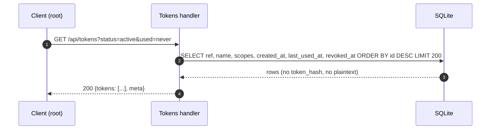

# GET /api/tokens

**Auth.** **Root session only** — a token listing credentials would be a privilege
escalation, so this route has no scope and answers `403 forbidden` to a Bearer credential.

## Purpose

List the issued tokens with their scopes and their state (used, revoked). Never the secret.

## Upstream

The settings screen.

## Downstream

`Module.Tokens.List` → `Repository.Sqlite.ListTokens`, newest first, at most 200 rows.

## Path / query params

| param | notes |
| --- | --- |
| `status` | `active` or `revoked` |
| `used` | `used` or `never`: filtered on `last_used_at` |
| `cursor`, `limit` | the shared paging (default 50, max 200) |

## Body

None.

## Response

`200` with `{"tokens": [...], "meta": {...}}`; each row is `ref`, `name`, `preview`
(`spl_ab12…9f3c`), `scopes`, `created_at`, and `last_used_at` / `revoked_at` when set.
There is no `token` field: the plaintext exists only in the `201` that created it, and the
preview is four characters at each edge of it.

## Errors

`403 forbidden` for a token.

## Limitations

Revoked rows stay listed on purpose: the credential stops working, the record does not
disappear. Pass `?status=active` to hide them.

## Sequence

