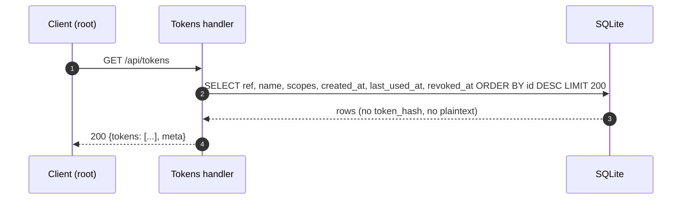

# GET /api/tokens

**Auth.** **Root session only** — a token listing credentials would be a privilege
escalation, so this route has no scope and answers `403 forbidden` to a Bearer credential.

## Purpose

List the issued tokens with their scopes and their state (used, revoked). Never the secret.

## Upstream

The settings screen.

## Downstream

`Module.Tokens.List` → `Repository.Sqlite.ListTokens`, newest first, at most 200 rows.

## Path / query params

None.

## Body

None.

## Response

`200` with `{"tokens": [...], "meta": {...}}`; each row is `ref`, `name`, `scopes`,
`created_at`, and `last_used_at` / `revoked_at` when set. There is no `token` field: the
plaintext exists only in the `201` that created it.

## Errors

`403 forbidden` for a token.

## Limitations

No cursor paging (the list is capped at 200). Revoked rows stay listed on purpose: the
credential stops working, the record does not disappear.

## Sequence

