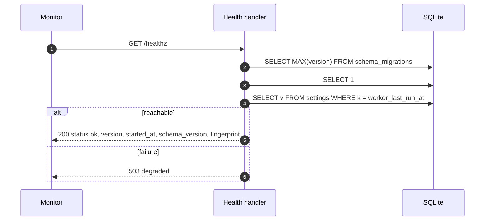

# GET /healthz

**Auth.** None: the route answers without a credential.

## Purpose

Prove the process is alive, which build it is and when this process booted, and that the
database is reachable — the first call any monitor, agent or release script makes.

## Upstream

Container healthcheck, `skills/release`, an agent's first call.

## Downstream

`Repository.Sqlite.SchemaVersion` (`SELECT MAX(version)`),
`Repository.Sqlite.Ping` (`SELECT 1`) and `Repository.Sqlite.Setting`
(`worker_last_run_at`). It makes no vendor call.

## Path / query params

None.

## Body

None.

## Response

```json
{"status":"ok","version":"v0.1.1+e0d15ce","started_at":"2026-04-15T08:00:00Z","schema_version":1,"app_secret":"41539bfba9c4a1ec","base_currency":"IDR","timezone":"UTC","worker_last_run_at":"2026-04-15T09:00:00Z"}
```

## Errors

`503 degraded` with the database error message when either query fails.

## Limitations

No deep checks (no FX fetch, no vendor ping); `app_secret` is a
fingerprint, never the secret. `base_currency` and `timezone` are the values
captured at boot; `timezone` is the IANA name the instance was pinned to
(`APP_TIMEZONE`, default `UTC`) and it is read-only.
`started_at` is the UTC RFC3339 time this process booted. It changes on every restart;
the durable history of earlier boots is in `/api/audit`
(`entity_kind=system`, `action=start`).
`worker_last_run_at` is the heartbeat of the recurring worker: RFC3339 for the last run
that finished every stage, and empty when it never completed a run or when the process
was started in `http` mode.


---

## Sequence


