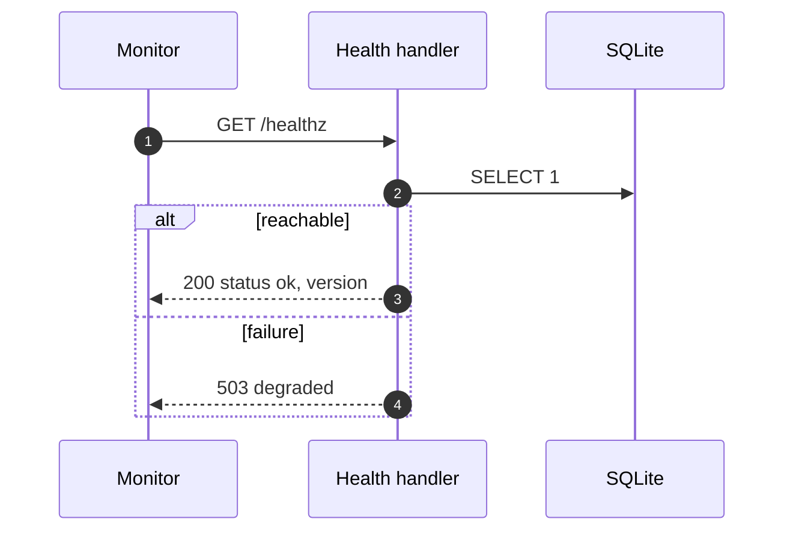

# GET /healthz

**Auth.** None: the route answers without a credential.

## Purpose

A probe, not a dashboard: `200` while the database answers its ping, `503` when it does not,
and the build named in the body so a container can prove which image it is running. It is the
first call any monitor, agent or release script makes.

## Upstream

Container healthcheck, `skills/release`, an agent's first call, the SPA's footer.

## Downstream

`Repository.Sqlite.Ping` (`SELECT 1`). Nothing else: no schema query, no settings read, no
vendor call. The boot state that used to be read here lives in `GET /api/bootstrap`, and the
sealed secret's fingerprint in `GET /api/meta`.

## Path / query params

None.

## Body

None.

## Response

```json
{"status":"ok","version":"v0.1.1+e0d15ce"}
```

`version` is `<tag>+<sha7>`, or `dev` from a local build.

## Errors

`503 degraded` with the database error message when the ping fails.

## Limitations

No deep checks (no FX fetch, no vendor ping, no queue state). The facts this route used to
publish — `started_at`, `schema_version`, `base_currency`, `timezone`, `worker_last_run_at` and
the `app_secret` fingerprint — moved on purpose: boot state belongs to `/api/bootstrap`, where a
client already looks before it holds a credential, and the fingerprint belongs to `/api/meta`,
because an 8-hex digest is not the secret but it is not a public fact either. `started_at`
changes on every restart; the durable history of earlier boots is in `/api/audit`
(`entity_kind=system`, `action=start`).

## Sequence


