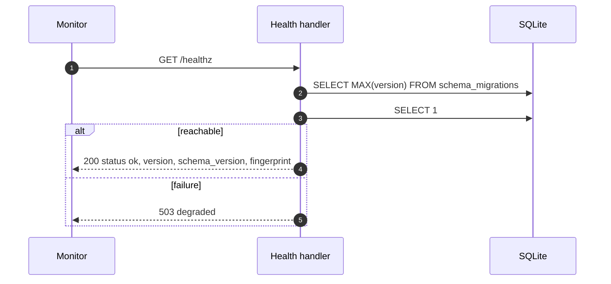

# GET /healthz

**Auth.** None: the route answers without a password.

## Purpose

Prove the process is alive, which build it is, and that the database is
reachable — the first call any monitor, agent or release script makes.

## Upstream

Container healthcheck, `skills/release`, an agent's first call.

## Downstream

`Repository.Sqlite.SchemaVersion` (`SELECT MAX(version)`), then
`Repository.Sqlite.Ping` (`SELECT 1`). It does

## Path / query params

None.

## Body

None.

## Response

```json
{"status":"ok","version":"v0.1.1+e0d15ce","schema_version":1,"app_secret":"41539bfba9c4a1ec","base_currency":"IDR","timezone":"UTC","worker_last_run_at":"2026-04-15T00:00:00Z"}
```

## Errors

`503 degraded` with the database error message when either query fails.

## Limitations

No deep checks (no FX fetch, no vendor ping); `app_secret` is a
fingerprint, never the secret. `base_currency` and `timezone` are the values
captured at boot; `timezone` is the IANA name the instance was pinned to
(`APP_TIMEZONE`, default `UTC`) and it is read-only.
`worker_last_run_at` is the heartbeat of the recurring worker: RFC3339 for the last
run it finished, and empty when it never ran or when the process was started in
`http` mode.


---

## Sequence


