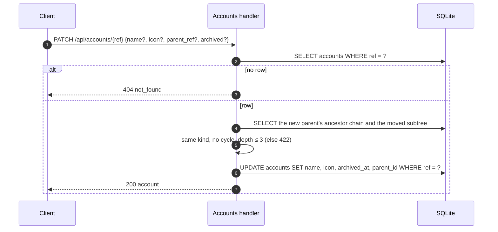

# PATCH /api/accounts/{ref}

**Auth.** `Authorization: Bearer <credential>`: the instance password, or a token carrying this route's scope. Open mode passes everything through; with a password set, a missing or wrong credential is `401 unauthorized`, and a token without the scope is `403 forbidden`.

## Purpose

Change what an account says about itself: its name, its icon, its parent, or whether it
is archived. Archiving hides it from pickers while every historical posting keeps
pointing at it — nothing is deleted, ever.

## Upstream

"Rename account", the icon picker, "move under a parent", "archive" from the accounts
screen.

## Downstream

`Repository.Sqlite.AccountByRef` to load the row, then `UpdateAccount`: one `UPDATE` of
`name`, `icon`, `archived_at`, `parent_id`. A sent `parent_ref` is resolved in the same
transaction, which refuses a parent of another `kind`, a chain deeper than three levels
(the moved subtree counts) and a cycle.

## Path / query params

| name | type | required | notes |
| --- | --- | --- | --- |
| `ref` | string | yes | the account's dashless UUID |

## Body

| field | type | required | notes |
| --- | --- | --- | --- |
| `name` | string | no | ≤ 80 characters |
| `icon` | string | no | ≤ 32 characters, opaque to the API |
| `parent_ref` | ref | no | an account of the same `kind`; `""` clears the parent, an omitted field keeps it |
| `archived` | bool | no | `true` stamps `archived_at`, `false` clears it |

An empty object `{}` is accepted and changes nothing — unlike `PATCH /api/settings`,
there is no "nothing to change" refusal, because the row is re-written as it is. A
zero-byte body decodes to nothing, so it is `400 invalid_json` instead: the body must
parse.

## Response

**200** the account detail: the row `POST /api/accounts` answers, plus `icon` (omitted
when unset).

## Errors

`404 not_found` when no account carries that `ref`; `422 invalid_request` for a name or
icon over the limit, a parent of another `kind`, a move that would close a cycle, and a
move that would push the subtree below the third level; `422 unknown_reference` when
`parent_ref` names no account; `409 duplicate` when a rename lands on an existing
`name` + `kind`.

## Limitations

No kind change: `kind` is what the double-entry invariants and the past balances are
built on, so archive the account and create a new one instead. Reparenting is allowed
within one `kind` and stops at three levels (`child → parent → grandparent`).

## Sequence

