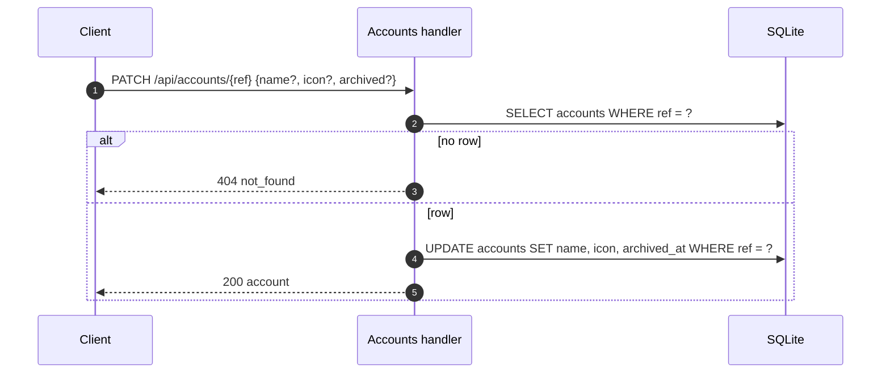

# PATCH /api/accounts/{ref}

**Auth.** Session cookie (`spenicle_session`). Open mode passes everything through; with a password set, a missing or stale cookie is `401 unauthorized`.

## Purpose

Change what an account says about itself: its name, its icon, or whether it is
archived. Archiving hides it from pickers while every historical posting keeps
pointing at it — nothing is deleted, ever.

## Upstream

"Rename account", the icon picker, "archive" from the accounts screen.

## Downstream

`Repository.Sqlite.AccountByRef` to load the row, then `UpdateAccount`: one `UPDATE`
of `name`, `icon`, `archived_at`.

## Path / query params

| name | type | required | notes |
| --- | --- | --- | --- |
| `ref` | string | yes | the account's dashless UUID |

## Body

| field | type | required | notes |
| --- | --- | --- | --- |
| `name` | string | no | ≤ 80 characters |
| `icon` | string | no | ≤ 32 characters, opaque to the API |
| `archived` | bool | no | `true` stamps `archived_at`, `false` clears it |

An empty body is accepted and changes nothing — unlike `PATCH /api/settings`, there is
no "nothing to change" refusal, because the row is re-written as it is.

## Response

**200** the account, same shape as `POST /api/accounts`.

## Errors

`404 not_found` when no account carries that `ref`; `422 invalid_request` for a name or
icon over the limit.

## Limitations

No reparenting and no kind change: moving an account under another one would rewrite
the meaning of past balances, and changing `kind` would break the double-entry
invariants that reference it. Archive and create a new one instead.

## Sequence

